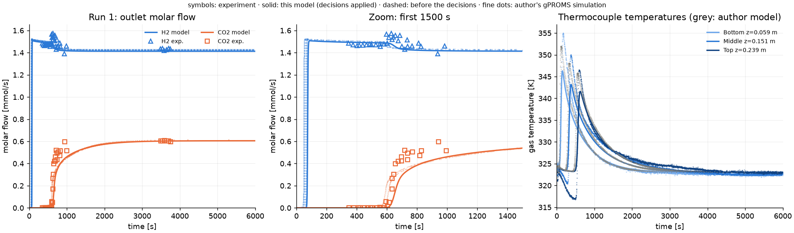
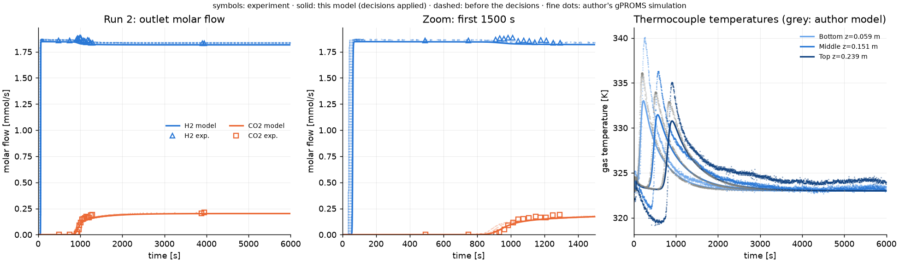
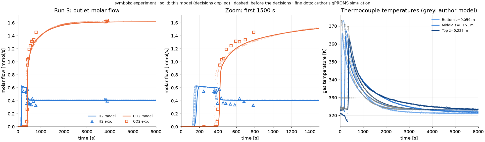
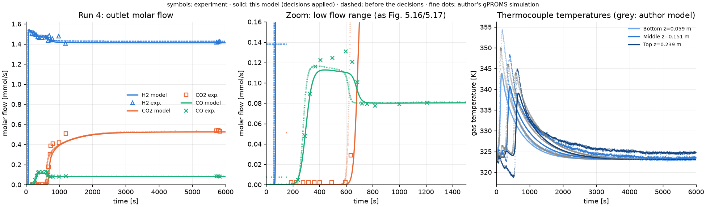
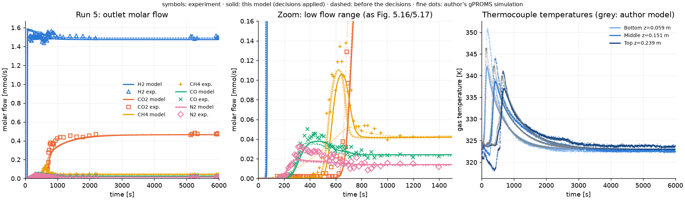

# Step 2 — column model validated on breakthrough curves

Generated by `scripts/run_breakthrough.py` (do not edit by hand; rerun the script). Thermal calibration:
`scripts/calibrate_thermal.py` (not adopted, see below).
Model: `src/h2psa/column.py` (Lopes 2010 eqs 5.3-5.16), N = 60 finite volumes, BDF.
Experiment: Lopes (2010) Figs 5.15-5.17, digitised in `data/benchmarks/digitized/`.

## Decisions applied (project lead, 2026-10-09)

1. **CH4 kinetics, option (c), errata E7.** Table 5.7 micropore constants for H2, CO2, CO, N2; CH4 from the
   Arrhenius refit of the measured Table 4.10 values (`psa_transport.micropore_use_measured: [CH4]`). Rule: a printed
   PSA-simulation constant is replaced only if it contradicts both the measured value on the same adsorbent and the
   author's own simulated curve. Option (b) (Table 4.10 for all species) is kept as a sensitivity case.
2. **H2 co-adsorption.** Mixture rule selectable in YAML (`isotherm.mixing`): `taqvi_levan` (default, published),
   `iast` (new; IAST on the pure virial isotherms), `noncompetitive_h2` (bound). All three are reported; none is
   selected here.
3. **Thermal calibration** of Cps and the lumped wall heat capacity per unit length on runs 1-3 (thermocouples + CO2
   t10/t50 jointly); runs 4-5 held out. **Stopped: a parameter ended on its bound; not adopted.**
4. **Particle specific area:** diagnostic only (2/R_p vs 3/R_p vs 2/R_p + 2/L_p); adoption rule: only if it follows
   from the particle geometry in the thesis.
5. Report copied to `docs/validation/step2.md` (committed).

"before" below = the model of the first step-2 report (Table 5.7 kinetics for all species, assumed Cps 880 J/kg/K
and 3 mm wall); "final" = the decisions applied (without the thermal calibration, see below).

## Summary

* Numerical gates: **PASS** (mole balance, grid convergence, linear-isotherm limit), final model.
* Breakthrough times vs experiment: **15/18 within 10 %** (before: 16/18); gate
  **FAIL**. Failing: run 5 CH4 t10 (+20%), run 5 CH4 t50 (+10%), run 5 N2 t10 (+13%).
* Thermal calibration **stopped, not adopted**: Cw on a bound (Cps = 1061 J/kg/K, Cw = 317 J/m/K = lower bound, i.e. a 0.5 mm wall). The final model keeps the assumed thermal values.
* Temperature peaks (final): ordering correct in all runs: True; 8 of 15 peaks within
  ±30% rise and ±20% time; rise error median -27%, range -41% to +2%.
* Runtime: 9 s per breakthrough (6000 s) at N = 60 with Taqvi-LeVan,
  218 s with IAST.

## Before / after

Breakthrough-time error vs experiment (`role`: CO2 times of runs 1-3 were in the calibration objective).

| role | run | species | level | before | after |
|---|---|---|---|---|---|
| fit | 1 | CO2 | t10 | +3.2% | +3.2% |
| fit | 1 | CO2 | t50 | +9.6% | +9.6% |
| fit | 2 | CO2 | t10 | -3.2% | -3.2% |
| fit | 2 | CO2 | t50 | +1.0% | +1.0% |
| fit | 3 | CO2 | t10 | +4.6% | +4.6% |
| fit | 3 | CO2 | t50 | +2.8% | +2.8% |
| held out | 4 | CO2 | t10 | +4.4% | +4.4% |
| held out | 4 | CO2 | t50 | +5.8% | +5.8% |
| held out | 4 | CO | t10 | +1.0% | +1.0% |
| held out | 4 | CO | t50 | +1.8% | +1.8% |
| held out | 5 | CO2 | t10 | +1.0% | +1.6% |
| held out | 5 | CO2 | t50 | +7.1% | +7.2% |
| held out | 5 | CH4 | t10 | -53.3% | +20.3% |
| held out | 5 | CH4 | t50 | -13.8% | +10.4% |
| held out | 5 | CO | t10 | +4.9% | +8.8% |
| held out | 5 | CO | t50 | +3.5% | +7.1% |
| held out | 5 | N2 | t10 | +9.7% | +13.2% |
| held out | 5 | N2 | t50 | -5.0% | -1.9% |

Thermocouples (`rms`: RMS of T_sim - T_exp over 0-2500 s; `rise_err`: error of the peak rise above 323 K).

| role | run | tc | exp_peak_K | peak_before_K | peak_after_K | rise_err_before | rise_err_after | rms_before_K | rms_after_K | peak_fit_K | rise_err_fit | rms_fit_K |
|---|---|---|---|---|---|---|---|---|---|---|---|---|
| fit | 1 | Bottom | 354.9 | 346.3 | 346.3 | -27% | -27% | 2.74 | 2.74 | 347.0 | -25% | 2.19 |
| fit | 1 | Middle | 349.9 | 343.2 | 343.2 | -25% | -25% | 2.04 | 2.04 | 344.4 | -20% | 1.84 |
| fit | 1 | Top | 346.5 | 341.6 | 341.6 | -21% | -21% | 2.47 | 2.47 | 342.5 | -17% | 2.39 |
| fit | 2 | Bottom | 340.0 | 333.0 | 333.0 | -41% | -41% | 2.06 | 2.06 | 333.9 | -36% | 1.77 |
| fit | 2 | Middle | 336.2 | 331.5 | 331.5 | -36% | -36% | 1.82 | 1.82 | 332.3 | -30% | 1.77 |
| fit | 2 | Top | 335.0 | 330.8 | 330.8 | -35% | -35% | 2.22 | 2.22 | 331.4 | -30% | 2.24 |
| fit | 3 | Bottom | 373.1 | 366.1 | 366.1 | -14% | -14% | 6.19 | 6.19 | 364.4 | -17% | 5.20 |
| fit | 3 | Middle | 367.4 | 364.2 | 364.2 | -7% | -7% | 5.21 | 5.21 | 363.4 | -9% | 4.88 |
| fit | 3 | Top | 362.6 | 363.2 | 363.2 | +2% | +2% | 3.97 | 3.97 | 362.4 | -0% | 3.58 |
| held out | 4 | Bottom | 354.3 | 343.9 | 343.9 | -33% | -33% | 3.18 | 3.18 | 344.8 | -30% | 2.70 |
| held out | 4 | Middle | 348.3 | 340.7 | 340.7 | -30% | -30% | 2.78 | 2.78 | 341.9 | -25% | 2.63 |
| held out | 4 | Top | 344.9 | 339.1 | 339.1 | -27% | -27% | 2.67 | 2.67 | 339.9 | -23% | 2.60 |
| held out | 5 | Bottom | 350.7 | 342.4 | 342.1 | -30% | -31% | 2.45 | 2.50 | 343.1 | -28% | 1.97 |
| held out | 5 | Middle | 343.9 | 339.3 | 338.7 | -22% | -25% | 1.46 | 1.58 | 340.1 | -18% | 1.39 |
| held out | 5 | Top | 341.0 | 337.7 | 337.0 | -18% | -22% | 2.05 | 2.22 | 338.0 | -17% | 2.23 |

Calibration objective per run (same definition for all runs; lower is better).

| role | run | before | final | thermal: bounded fit (not adopted) |
|---|---|---|---|---|
| fit | 1 | 136.9 | 136.9 | 45.0 |
| fit | 2 | 26.9 | 26.9 | 36.6 |
| fit | 3 | 125.6 | 125.6 | 89.8 |
| held out | 4 | 40.5 | 40.5 | 29.9 |
| held out | 5 | 110.3 | 117.0 | 43.2 |

## Thermal calibration (decision 3) — stopped: parameter on a bound

* Parameters: solid heat capacity Cps and wall heat capacity per unit length Cw = rho_w Cp_w pi e (d_wi + e), one
  lumped parameter (the wall terms of eq. 5.11 depend on e only through Cw, up to e/2d_wi <= 5 % in the outer exchange
  term; e stays at 3 mm there). Bounds: Cps 600-1200 J/kg/K; Cw from 0.5-5 mm stainless steel.
* Fit data: runs 1, 2, 3, thermocouple histories 0-2500 s and CO2 t10/t50; kinetics, isotherm and transport
  fixed; runs 4-5 and the PSA experiment held out.
* Objective: sum over runs of [sum over the 3 thermocouples of mean((T_sim - T_exp)^2)/sigma_T^2 + sum over CO2 t10, t50
  of ((t_sim - t_exp)/sigma_t)^2]. Weights: each thermocouple history counts as one observation of its mean-square error
  (9 terms), each CO2 crossing time as one observation (6 terms); sigma_T = RMS thermocouple deviation from 323 K after
  4000 s (runs 1-3), sigma_t = half the GC sampling interval bracketing the crossing (+) 2.4 s read-off (5-15 s).
* Assumed values (kept in `assumed:`): Cps 880 J/kg/K, wall 3 mm stainless steel.
* Result (`scripts/calibrate_thermal.py`, 2026-10-09, 11 evaluations): Cps = 1061 ± 430 J/kg/K,
  **Cw = 317 ± 1619 J/m/K, on its lower bound** (317; a 0.50 mm stainless wall),
  correlation -0.94. Uncertainties from the Gauss-Newton Hessian, scaled by chi2 per observation-equivalent
  (13.2: the residual is dominated by model error, not by measurement uncertainty). Objective
  289.4 -> 171.4.
* Per decision 3 the fit is **not adopted**: no `calibrated:` block was written; the final model uses the `assumed:` values.
* What drives it (sum over runs 1-5): temperature term 207.7 -> 168.3,
  CO2-time term 232.6 -> 76.2 (assumed values -> bounded fit). The CO2 term
  is dominated by the run-1 t50 error (front shape, see the particle-area section), which the thermal parameters can only
  partly offset; Cps and Cw trade off against each other (correlation -0.94).
* Held-out runs 4-5 with the bounded fit (diagnostic): thermocouple RMS 2.43 K (assumed) -> 2.25 K,
  peak-rise error -28% -> -24% (median).
* Options for your decision: (a) keep the assumed values and report the temperature bias; (b) widen the Cw bound below
  0.5 mm, i.e. accept a wall that stores almost no heat (physically questionable for a steel column); (c) fit on the
  thermocouple histories only (the CO2 front-shape error then no longer drives the thermal parameters); (d) add a third
  parameter (e.g. hw or U), which Table 5.7 reports from correlations.

## CH4 kinetics (decision 1, errata E7)

With the Table 4.10 refit for CH4 the run-5 CH4 errors are t10 +20%, t50 +10%
(outside the 10 % gate; the Table 5.7 constants gave
-53% / -14%). Side effect on the other minor species of run 5 (same run, no other
change): N2 t10 +9.7% -> +13.2% (now outside the gate),
CO t10 +4.9% -> +8.8%: with CH4 adsorbing at the measured rate, the N2 and CO fronts arrive later.
**Known limitation:** CH4 t10 stays outside the gate. For context, the author's own model misses the same quantity
by +14% (t10 478 s vs 421 s measured), and the sensitivity case (b) gives +20%.
Which impurity limits product purity:
* Run 5 (breakthrough): N2 breaks through first (measured t10: N2 163 s, CO 226 s,
  CH4 421 s, CO2 677 s). In the final model the He-free H2 purity drops below 99.99 %
  at 157 s, with the impurity made up of CO 3%, N2 97%: **N2** limits purity.
  CH4 arrives last of the minor impurities; its kinetics act on purity only indirectly, through the N2 and CO fronts (above).
* PSA experiment (held out, not simulated here): 99.9805 % H2, i.e. 195 ppm impurities, of which
  the thesis attributes 63 ppm to CO (p.191); the remaining 132 ppm are not
  attributed. In the author's simulations of the same unit the product impurities are "CH4, CO and, mainly N2" (p.199).
  CO is the specification-relevant impurity (fuel cells, < 10 ppm, p.158) and N2 the first to break through; CH4 is
  neither.

## H2 co-adsorption: three mixture rules (decision 2)

H2 loading at the feed (5 bar, 323 K) [mol/kg] under each rule, and the IAST spreading pressure (psi, mol/kg) with the
species whose pure virial isotherm cannot reach it:

| run | taqvi_levan | iast | iast_psi | iast_past_psi_max | pure_H2_at_P_H2 |
|---|---|---|---|---|---|
| 1 | 9.99e-04 | 1.67e-02 | 2.90 | N2 | 1.12e-01 |
| 2 | 5.21e-02 | 6.90e-02 | 1.24 | none | 1.42e-01 |
| 3 | 7.31e-09 | 7.12e-04 | 5.86 | CO, CH4, N2 | 3.20e-02 |
| 4 | 2.05e-03 | 1.99e-02 | 2.64 | N2 | 1.12e-01 |
| 5 | 3.69e-03 | 2.38e-02 | 2.44 | N2 | 1.16e-01 |

IAST implementation (`Virial(mixing="iast")`): reduced spreading pressure of the pure virial isotherm
psi = q + (A/S) q^2 + (B/S^2) q^3 in closed form; safeguarded Newton on ln psi with a nested Newton for each pure
loading. Tests: exact reduction to the pure isotherm (< 1e-9) and the Gibbs adsorption isotherm d psi/d ln P_i = q_i
(< 1e-5) for binary, five-component and trace states (`tests/test_isotherms.py`). **Limitation found:** for CO, CH4
and N2 the pure virial fits turn over (P(q) has a maximum at 11-25 bar, beyond the 0-7 bar fit), so psi cannot exceed
psi_max (N2 2.33, CO 3.95, CH4 5.47 mol/kg at 323 K). IAST needs these hypothetical pure states whenever CO2 is loaded;
above psi_max the pure isotherm is continued at constant loading (saturated), which keeps IAST defined and consistent
but makes its weak-species loadings an extrapolation. Species past psi_max at the feed are listed in the table.

H2 outlet flow / H2 feed flow (windows defined by the measured CO2 front: `before` it, `peak` around it, `late` after
2500 s, where 1.000 is exact):

| run | case | exp_before | sim_before | exp_peak | sim_peak | exp_late | sim_late | n_before |
|---|---|---|---|---|---|---|---|---|
| 1 | taqvi_levan (final) | 1.041 | 1.055 | 1.114 | 1.055 | 1.013 | 1.000 | 12 |
| 1 | iast | 1.041 | 1.050 | 1.114 | 1.050 | 1.013 | 1.000 | 12 |
| 1 | noncompetitive_h2 | 1.041 | 1.031 | 1.114 | 1.031 | 1.013 | 1.000 | 12 |
| 2 | taqvi_levan (final) | 1.023 | 1.016 | 1.038 | 1.016 | 1.009 | 1.000 | 2 |
| 2 | iast | 1.023 | 1.014 | 1.038 | 1.014 | 1.009 | 1.000 | 2 |
| 2 | noncompetitive_h2 | 1.023 | 1.006 | 1.038 | 1.006 | 1.009 | 1.000 | 2 |
| 3 | taqvi_levan (final) | 1.345 | 1.508 | 1.436 | 1.526 | 1.014 | 1.000 | 2 |
| 3 | iast | 1.345 | 1.505 | 1.436 | 1.522 | 1.014 | 1.000 | 2 |
| 3 | noncompetitive_h2 | 1.345 | 1.467 | 1.436 | 1.483 | 1.014 | 1.000 | 2 |
| 4 | taqvi_levan (final) | 1.049 | 1.053 | 1.052 | 1.041 | 1.006 | 1.000 | 8 |
| 4 | iast | 1.049 | 1.049 | 1.052 | 1.037 | 1.006 | 1.000 | 8 |
| 4 | noncompetitive_h2 | 1.049 | 1.031 | 1.052 | 1.021 | 1.006 | 1.000 | 8 |
| 5 | taqvi_levan (final) | 1.015 | 1.047 | 1.060 | 1.042 | 1.018 | 1.000 | 38 |
| 5 | iast | 1.015 | 1.043 | 1.060 | 1.038 | 1.018 | 1.000 | 38 |
| 5 | noncompetitive_h2 | 1.015 | 1.026 | 1.060 | 1.021 | 1.018 | 1.000 | 38 |

Run 1 (30 % CO2), H2 flow before the CO2 front: measured 1.041; Taqvi-LeVan
1.055, IAST 1.050, bound 1.031. Measured late-plateau offset
+1.3%. Run 3 (80 % CO2): measured 1.345; 1.508 /
1.505 / 1.467. The three rules span a band that the breakthrough data cannot narrow; in
step 3 the band is carried into purity and recovery.

## Particle specific area (decision 4, diagnostic)

The thesis gives AC5-KS only as cylindrical extrudates with R_p = 1.45 mm (Table 4.5) and uses the infinite-cylinder
LDF factor Omega_p = 8 (Table 4.7); no AC5-KS pellet length is reported. The parent R2030 extrudates (same 2.90 mm
diameter) are 6.45 mm long (Table 3.2), used here for the finite-cylinder case only.

| run | species | exp_width_s | width 2/Rp | t50 err 2/Rp | width 3/Rp | t50 err 3/Rp | width 2/Rp+2/Lp | t50 err 2/Rp+2/Lp |
|---|---|---|---|---|---|---|---|---|
| 1 | CO2 | 28 | 71 | +9.6% | 70 | +9.8% | 70 | +9.7% |
| 2 | CO2 | 69 | 108 | +1.0% | 106 | +1.0% | 107 | +1.0% |
| 3 | CO2 | 23 | 16 | +2.8% | 16 | +3.3% | 16 | +3.0% |
| 4 | CO | 38 | 40 | +1.8% | 40 | +1.9% | 40 | +1.9% |
| 4 | CO2 | 63 | 76 | +5.8% | 75 | +6.0% | 76 | +5.9% |
| 5 | CH4 | 68 | 33 | +10.4% | 32 | +10.8% | 33 | +10.6% |
| 5 | CO | 49 | 49 | +7.1% | 48 | +7.3% | 48 | +7.2% |
| 5 | CO2 | 46 | 86 | +7.2% | 84 | +7.3% | 85 | +7.2% |
| 5 | N2 | 60 | 34 | -1.9% | 34 | -1.7% | 34 | -1.8% |

Run 1 CO2 front width (t50 - t10): measured 28 s; 2/R_p 71 s, 3/R_p 70 s,
2/R_p + 2/L_p 70 s. **Not adopted:** 3/R_p is the sphere value and contradicts the cylindrical
extrudates; the end-face term needs a pellet length the thesis does not give for AC5-KS, and the thesis's own particle
model is the infinite cylinder. a_p = 2/R_p stays (`assumed:` block). The effect on the front width is small in either
case, so a_p does not explain the steeper measured CO2 front.

## Numerical gates (final model)

| gate | worst | limit | passed |
|---|---|---|---|
| grid t50 N=60->120 | 3.03e-03 | 1e-02 | True |
| linear isotherm vs t_st | 5.93e-03 | 1e-02 | True |
| mole balance | 6.01e-08 | 1e-03 | True |

Mole balance: worst |closure| over runs 1-5, per component and overall. Grid: t50 of every adsorbing species, N = 60
vs 120. Linear limit: single tracer (1 % in He), isothermal, q = K P, t_st = 646.1 s.

## Breakthrough times vs experiment, final model (gate: |error| <= 10%)

H2 is not in the table: the first H2 sample of every run is taken after H2 has already broken through.

| run | species | level | sim_s | exp_s | rel_err | within_10pct |
|---|---|---|---|---|---|---|
| 1 | CO2 | t10 | 636 | 617 | +3.2% | True |
| 1 | CO2 | t50 | 707 | 645 | +9.6% | True |
| 2 | CO2 | t10 | 898 | 928 | -3.2% | True |
| 2 | CO2 | t50 | 1007 | 997 | +1.0% | True |
| 3 | CO2 | t10 | 413 | 395 | +4.6% | True |
| 3 | CO2 | t50 | 429 | 417 | +2.8% | True |
| 4 | CO2 | t10 | 669 | 641 | +4.4% | True |
| 4 | CO2 | t50 | 745 | 704 | +5.8% | True |
| 4 | CO | t10 | 245 | 243 | +1.0% | True |
| 4 | CO | t50 | 285 | 280 | +1.8% | True |
| 5 | CO2 | t10 | 688 | 677 | +1.6% | True |
| 5 | CO2 | t50 | 775 | 723 | +7.2% | True |
| 5 | CH4 | t10 | 506 | 421 | +20.3% | False |
| 5 | CH4 | t50 | 539 | 488 | +10.4% | False |
| 5 | CO | t10 | 246 | 226 | +8.8% | True |
| 5 | CO | t50 | 294 | 275 | +7.1% | True |
| 5 | N2 | t10 | 185 | 163 | +13.2% | False |
| 5 | N2 | t50 | 219 | 223 | -1.9% | True |

Sensitivity and diagnostic cases (relative error; within 10 %: kinetics (b): Table 4.10 for all species 14/18, mixing: iast 15/18, mixing: noncompetitive_h2 14/18, a_p = 3/R_p (sphere) 15/18, a_p = 2/R_p + 2/L_p (finite cylinder) 15/18, thermal: bounded fit (not adopted) 16/18):

| run | species | level | a_p = 2/R_p + 2/L_p (finite cylinder) | a_p = 3/R_p (sphere) | kinetics (b): Table 4.10 for all species | mixing: iast | mixing: noncompetitive_h2 | thermal: bounded fit (not adopted) |
|---|---|---|---|---|---|---|---|---|
| 1 | CO2 | t10 | +3.4% | +3.5% | +2.8% | +3.7% | +3.0% | +0.2% |
| 1 | CO2 | t50 | +9.7% | +9.8% | +9.8% | +9.3% | +9.3% | +4.7% |
| 2 | CO2 | t10 | -3.1% | -2.9% | -3.6% | -1.3% | -3.3% | -4.9% |
| 2 | CO2 | t50 | +1.0% | +1.0% | +1.1% | +3.8% | +0.8% | -0.9% |
| 3 | CO2 | t10 | +4.9% | +5.1% | +4.2% | +4.4% | +4.5% | +1.2% |
| 3 | CO2 | t50 | +3.0% | +3.3% | +2.9% | +2.6% | +2.8% | -1.2% |
| 4 | CO | t10 | +1.2% | +1.4% | +8.3% | +1.6% | +2.7% | +1.2% |
| 4 | CO | t50 | +1.9% | +1.9% | +3.3% | +2.4% | +3.0% | +1.8% |
| 4 | CO2 | t10 | +4.5% | +4.7% | +4.0% | +5.2% | +4.2% | +1.5% |
| 4 | CO2 | t50 | +5.9% | +6.0% | +6.0% | +5.9% | +5.6% | +1.8% |
| 5 | CH4 | t10 | +20.7% | +21.0% | +20.1% | +21.4% | +20.9% | +19.0% |
| 5 | CH4 | t50 | +10.6% | +10.8% | +10.2% | +11.4% | +10.7% | +8.9% |
| 5 | CO | t10 | +9.1% | +9.3% | +17.5% | +9.4% | +10.7% | +9.0% |
| 5 | CO | t50 | +7.2% | +7.3% | +9.4% | +7.7% | +8.6% | +7.1% |
| 5 | CO2 | t10 | +1.8% | +2.0% | +1.2% | +2.7% | +1.5% | -1.2% |
| 5 | CO2 | t50 | +7.2% | +7.3% | +7.3% | +7.7% | +6.9% | +3.8% |
| 5 | N2 | t10 | +13.5% | +13.7% | +18.5% | +13.9% | +15.5% | +13.3% |
| 5 | N2 | t50 | -1.8% | -1.7% | -0.8% | -1.3% | -0.2% | -1.8% |

## Temperature peaks, final model (qualitative gate)

"Qualitatively right": peak rise above 323 K within 30%, peak time within 20%, same Bottom -> Middle -> Top
ordering. sigma_T = 0.85 K (RMS thermocouple deviation from 323 K after 4000 s, runs 1-3). The early dip of the Top
thermocouple (heater switching off, p.191) is an experimental artefact the model does not contain.

| run | tc | sim_peak_K | exp_peak_K | rise_rel_err | sim_time_s | exp_time_s | time_rel_err | rms_K | qualitative_ok |
|---|---|---|---|---|---|---|---|---|---|
| 1 | Bottom | 346.3 | 354.9 | -27% | 149 | 165 | -10% | 2.74 | True |
| 1 | Middle | 343.2 | 349.9 | -25% | 379 | 375 | +1% | 2.04 | True |
| 1 | Top | 341.6 | 346.5 | -21% | 622 | 588 | +6% | 2.47 | True |
| 2 | Bottom | 333.0 | 340.0 | -41% | 230 | 257 | -11% | 2.06 | False |
| 2 | Middle | 331.5 | 336.2 | -36% | 568 | 570 | -0% | 1.82 | False |
| 2 | Top | 330.8 | 335.0 | -35% | 910 | 901 | +1% | 2.22 | False |
| 3 | Bottom | 366.1 | 373.1 | -14% | 90 | 124 | -27% | 6.19 | False |
| 3 | Middle | 364.2 | 367.4 | -7% | 234 | 251 | -7% | 5.21 | True |
| 3 | Top | 363.2 | 362.6 | +2% | 390 | 396 | -2% | 3.97 | True |
| 4 | Bottom | 343.9 | 354.3 | -33% | 160 | 176 | -9% | 3.18 | False |
| 4 | Middle | 340.7 | 348.3 | -30% | 405 | 390 | +4% | 2.78 | False |
| 4 | Top | 339.1 | 344.9 | -27% | 661 | 618 | +7% | 2.67 | True |
| 5 | Bottom | 342.1 | 350.7 | -31% | 167 | 185 | -10% | 2.50 | False |
| 5 | Middle | 338.7 | 343.9 | -25% | 426 | 405 | +5% | 1.58 | True |
| 5 | Top | 337.0 | 341.0 | -22% | 694 | 654 | +6% | 2.22 | True |

## Our model vs the author's gPROMS simulation (final model)

Author's curves vector-extracted from Figs 5.15-5.17 (±12 s on the 0-6000 s axes, ±3 s zoomed). Temperatures compare
the rise above 323 K.

| run | item | ours | author | rel_diff |
|---|---|---|---|---|
| 1 | CO2 t10 [s] | 636.4 | 578.4 | +10.0% |
| 1 | CO2 t50 [s] | 707.2 | 646.3 | +9.4% |
| 1 | T peak Bottom [K] | 346.3 | 352.0 | -19.6% |
| 1 | T peak Middle [K] | 343.2 | 348.1 | -19.7% |
| 1 | T peak Top [K] | 341.6 | 345.8 | -18.5% |
| 2 | CO2 t10 [s] | 898.4 | 852.6 | +5.4% |
| 2 | CO2 t50 [s] | 1006.8 | 940.0 | +7.1% |
| 2 | T peak Bottom [K] | 333.0 | 336.1 | -23.7% |
| 2 | T peak Middle [K] | 331.5 | 334.0 | -23.1% |
| 2 | T peak Top [K] | 330.8 | 332.9 | -21.9% |
| 3 | CO2 t10 [s] | 412.9 | 365.0 | +13.1% |
| 3 | CO2 t50 [s] | 429.0 | 374.7 | +14.5% |
| 3 | T peak Bottom [K] | 366.1 | 373.3 | -14.4% |
| 3 | T peak Middle [K] | 364.2 | 371.2 | -14.4% |
| 3 | T peak Top [K] | 363.2 | 370.0 | -14.5% |
| 4 | CO2 t10 [s] | 668.8 | 597.2 | +12.0% |
| 4 | CO2 t50 [s] | 745.0 | 650.4 | +14.5% |
| 4 | CO t10 [s] | 245.0 | 239.5 | +2.3% |
| 4 | CO t50 [s] | 285.4 | 265.9 | +7.3% |
| 4 | T peak Bottom [K] | 343.9 | 350.0 | -22.7% |
| 4 | T peak Middle [K] | 340.7 | 346.1 | -23.7% |
| 4 | T peak Top [K] | 339.1 | 344.0 | -23.4% |
| 5 | CO2 t10 [s] | 688.5 | 639.7 | +7.6% |
| 5 | CO2 t50 [s] | 774.8 | 714.2 | +8.5% |
| 5 | CH4 t10 [s] | 506.0 | 478.5 | +5.8% |
| 5 | CH4 t50 [s] | 539.2 | 508.2 | +6.1% |
| 5 | CO t10 [s] | 245.7 | 244.3 | +0.6% |
| 5 | CO t50 [s] | 294.4 | 281.0 | +4.8% |
| 5 | N2 t10 [s] | 184.9 | 174.7 | +5.8% |
| 5 | N2 t50 [s] | 219.2 | 208.7 | +5.0% |
| 5 | T peak Bottom [K] | 342.1 | 346.4 | -18.6% |
| 5 | T peak Middle [K] | 338.7 | 342.2 | -18.5% |
| 5 | T peak Top [K] | 337.0 | 339.9 | -17.2% |

## Runtime per breakthrough simulation (6000 s of process time)

| case | N | mean | min | max |
|---|---|---|---|---|
| a_p = 2/R_p + 2/L_p (finite cylinder) | 60 | 8.9 s | 3.8 s | 19.2 s |
| a_p = 3/R_p (sphere) | 60 | 8.7 s | 3.9 s | 19.0 s |
| before | 60 | 9.4 s | 4.3 s | 21.8 s |
| final | 60 | 8.9 s | 4.4 s | 19.2 s |
| final | 120 | 18.3 s | 5.2 s | 50.0 s |
| kinetics (b): Table 4.10 for all species | 60 | 8.5 s | 3.6 s | 18.6 s |
| mixing: iast | 60 | 218.0 s | 128.9 s | 362.8 s |
| mixing: noncompetitive_h2 | 60 | 9.7 s | 4.6 s | 20.0 s |
| thermal: bounded fit (not adopted) | 60 | 8.6 s | 3.8 s | 19.7 s |

## Figures

Symbols: experiment; solid: final model; dashed: before the decisions; fine dots: author's simulation.

