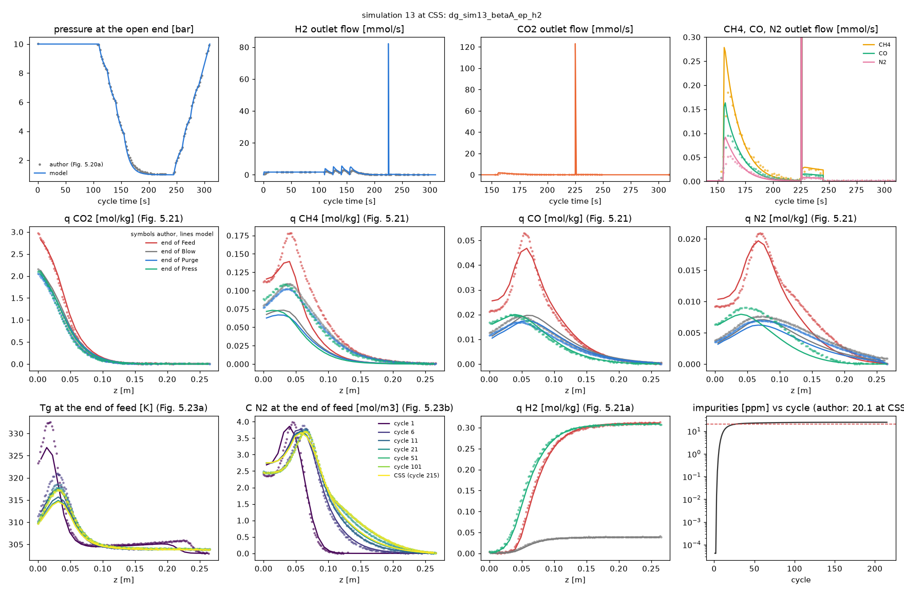
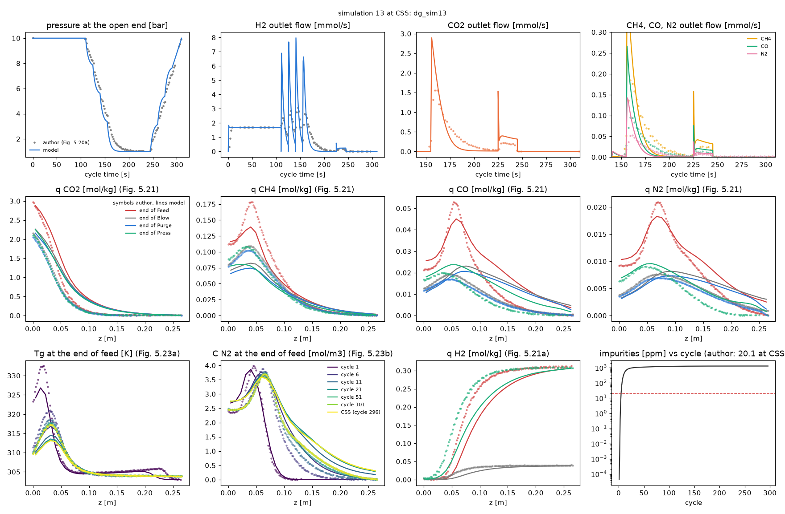
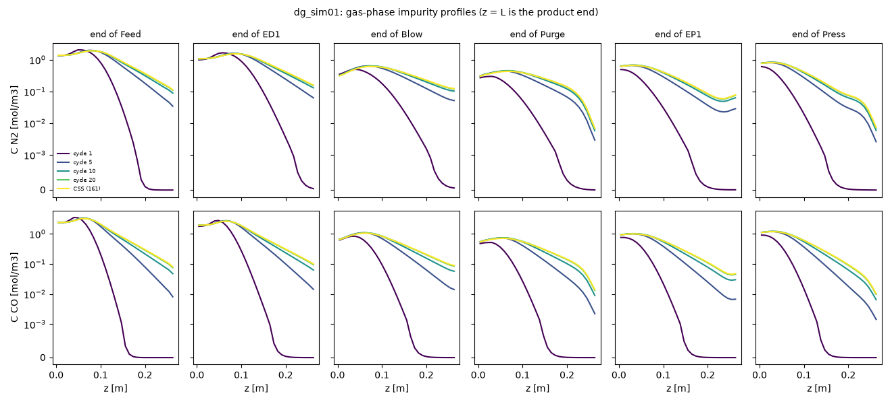
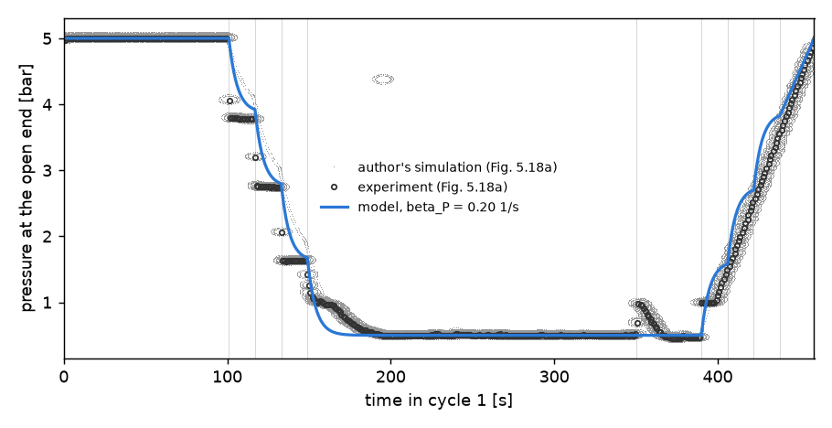
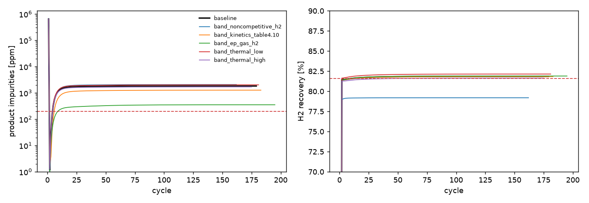
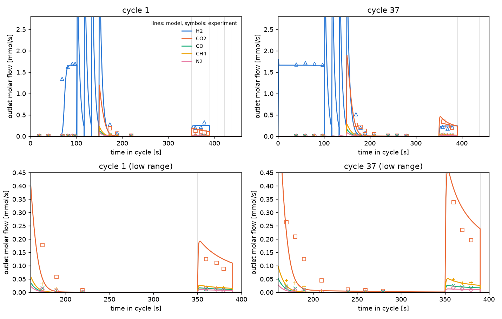
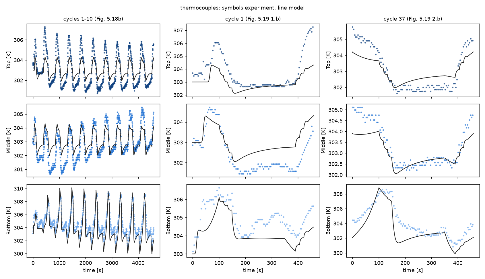
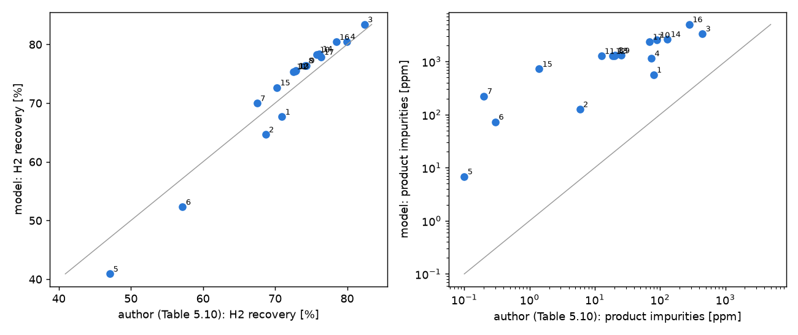

# Step 3 — single-column PSA cycle to CSS, validated on the PSA experiment

Generated by `scripts/run_psa.py` (cases cached in `results/step3/cases/`). Thesis pages are printed pages.

## Verdict

Status after the follow-up: verification against the author's model is **incomplete** — impurity is reproduced
within ~2x with two corrections inferred from the author's figures, recovery stays 4.0-4.6 pp low (target 2 pp).
Rung c and the post-correction experiment comparison were not run. The gates below are those of the **first**
comparison (pre-declared baseline).

| gate | result |
|---|---|
| 1. Numerical (CSS, mole balance, grid) | PASS |
| 2. Experiment (recovery, impurity ppm, CO ppm at CSS) | FAIL |
| 3. Author's 17 simulations (rank correlation, effect signs) | FAIL |

## Follow-up: reproducing the author's model (verification, project lead's decision (b))

**Principle.** The author's 17 simulations (Table 5.10, Figs 5.20-5.23) are a verification target for the
implementation; inferring from them what the author did is legitimate. The PSA experiment is not used to choose
anything. Rung c and the experiment rerun were **not** done: rung a does not meet its targets (below).

### 1. What the thesis says (quoted)

* p.166: "A PSA cycle of 10 elementary steps was employed (see Figure 5.7): a co-current feed, three pressure
  equalizations-depressurizations, a counter-current blowdown, a counter-current purge with hydrogen, three pressure
  equalizations-pressurizations and a counter-current pressurization with hydrogen."
* p.191: "In this single-column experiment, the pressure equalization was divided into three different steps to
  simulate the behaviour of an industrial PSA unit where several pressure equalization steps are required to
  increase H2 recovery."
* pp.178-180, eqs 5.44-5.45 (EP) and 5.46-5.47 (Press): the inlet condition is
  u0,inlet C_inlet,i = u0 C_g,i - eps Dax C_g,T dy_i/dz with u0,inlet C_inlet,T = u0 C_g,T; **C_inlet is not defined
  for EP**, and no pressure law is given for EP. Press: P = P_inter + (P_high - P_inter) t/t_press (eq. 5.47).
* p.180: "The simulations of the depressurization steps were performed using an exponential decay function until a
  pre-defined pressure (Pinter) is achieved (see equation (5.39)). When three successive pressure equalizations take
  place, three different pressure intervals are defined using exponential functions with the same exponential decay
  rate constant (betaP)."
* Fig. 5.5 (p.164): two columns, one tank, mass-flow controllers on the feed lines, a mass-flow meter and a
  back-pressure regulator on the product line, a vacuum pump. The text never says what the tank or column 2 did in
  the single-column experiment.
* pp.221-223 (chapter 6, same unit): equalisation between columns 1 and 2 reached "2.68, 2.28 and 1.85 bar instead
  of 3, 2.5 and 2 bar" because of dead volumes; "Since the dead volumes may result in significant changes to the
  experimental results, in this chapter, only experiments involving the fast cycling of a single-column PSA are
  reported."
* **p.256: "it was concluded that a hydrogen recovery of 81.6% was obtained in the PSA experiment with a H2 purity of
  99.98054% contaminated with 63 ppm of CO (simulated values) and a process productivity of 101.1 molH2 kgads-1
  day-1."** Chapter 6 states the practice (p.241): "Due to the small number of experimental points, report
  experimental values of these performance parameters may not be very accurate. Since the simulation predicts with
  good accuracy the experimental results obtained, the performance parameters based on simulated results were
  reported." **The experiment's purity, CO and recovery used in gate 2 are therefore the author's simulation of the
  experiment, not measurements.** The measured data of the experiment are the outlet flows at the GC sampling times
  (Fig. 5.19), the pressure (Fig. 5.18a) and the temperatures (Figs 5.18b, 5.19). Decision needed (below).

### 2. Rung a (cycle A, simulations 1 and 2) and simulation 13 — one hypothesis at a time

Target: impurity within a factor of 2 and recovery within 2 pp of Table 5.10.

| sim | case | ppm | ppm_author | ppm_ratio | co_ppm | co_author | recovery | d_recovery_pp | prod | prod_author | target |
|---|---|---|---|---|---|---|---|---|---|---|---|
| 1 | baseline (ED gas mixed, beta_P 0.20) | 559.9 | 79.3 | 7.06 | 223.59 | 15.2 | 67.67 | -3.29 | 86.2 | 91.6 | FAIL |
| 1 | (i) EP = pure H2 | 227.6 | 79.3 | 2.87 | 103.51 | 15.2 | 67.67 | -3.29 | 86.3 | 91.6 | FAIL |
| 1 | (i) EP = product gas | 281.5 | 79.3 | 3.55 | 126.68 | 15.2 | 67.67 | -3.29 | 86.3 | 91.6 | FAIL |
| 1 | (i) EP = ED gas, first out first in | 570.9 | 79.3 | 7.20 | 228.73 | 15.2 | 67.66 | -3.30 | 86.2 | 91.6 | FAIL |
| 1 | (i) EP = ED gas, last out first in | 692.2 | 79.3 | 8.73 | 262.66 | 15.2 | 67.66 | -3.30 | 86.2 | 91.6 | FAIL |
| 1 | (ii) beta_P per step type (Fig. 5.18a) | 1165.9 | 79.3 | 14.70 | 414.48 | 15.2 | 66.74 | -4.22 | 85.1 | 91.6 | FAIL |
| 1 | beta_P of the author (0.102, Fig. 5.20a) | 274.4 | 79.3 | 3.46 | 95.02 | 15.2 | 66.94 | -4.02 | 85.3 | 91.6 | FAIL |
| 1 | author beta_P + EP = pure H2 | 95.5 | 79.3 | 1.20 | 41.62 | 15.2 | 66.95 | -4.01 | 85.3 | 91.6 | FAIL |
| 1 | author beta_P + EP = product gas | 120.1 | 79.3 | 1.51 | 51.50 | 15.2 | 66.94 | -4.02 | 85.3 | 91.6 | FAIL |
| 2 | baseline (ED gas mixed, beta_P 0.20) | 125.6 | 5.9 | 21.29 | 48.28 | 0.705 | 64.66 | -4.02 | 79.7 | 85.6 | FAIL |
| 2 | (i) EP = pure H2 | 42.1 | 5.9 | 7.14 | 20.56 | 0.705 | 64.66 | -4.02 | 79.7 | 85.6 | FAIL |
| 2 | (i) EP = product gas | 51.7 | 5.9 | 8.76 | 24.82 | 0.705 | 64.66 | -4.02 | 79.7 | 85.6 | FAIL |
| 2 | (i) EP = ED gas, first out first in | 130.4 | 5.9 | 22.11 | 50.08 | 0.705 | 64.65 | -4.03 | 79.7 | 85.6 | FAIL |
| 2 | (i) EP = ED gas, last out first in | 162.1 | 5.9 | 27.48 | 57.13 | 0.705 | 64.66 | -4.02 | 79.7 | 85.6 | FAIL |
| 2 | (ii) beta_P per step type (Fig. 5.18a) | 639.5 | 5.9 | 108.40 | 234.93 | 0.705 | 63.83 | -4.85 | 78.7 | 85.6 | FAIL |
| 2 | beta_P of the author (0.102, Fig. 5.20a) | 48.6 | 5.9 | 8.24 | 15.09 | 0.705 | 64.07 | -4.61 | 79.0 | 85.6 | FAIL |
| 2 | author beta_P + EP = pure H2 | 14.1 | 5.9 | 2.39 | 6.09 | 0.705 | 64.07 | -4.61 | 79.0 | 85.6 | FAIL |
| 2 | author beta_P + EP = product gas | 17.6 | 5.9 | 2.98 | 7.46 | 0.705 | 64.07 | -4.61 | 79.0 | 85.6 | FAIL |
| 13 | baseline (ED gas mixed, beta_P 0.20) | 1291.2 | 20.1 | 64.24 | 485.96 | 4.85 | 75.51 | +2.63 | 150.3 | 146.0 | FAIL |
| 13 | (i) EP = pure H2 | 240.3 | 20.1 | 11.95 | 88.18 | 4.85 | 75.52 | +2.64 | 150.3 | 146.0 | FAIL |
| 13 | beta_P of the author (0.102, Fig. 5.20a) | 167.9 | 20.1 | 8.35 | 63.19 | 4.85 | 68.76 | -4.12 | 136.8 | 146.0 | FAIL |
| 13 | author beta_P + EP = pure H2 | 24.6 | 20.1 | 1.22 | 12.94 | 4.85 | 68.76 | -4.12 | 136.8 | 146.0 | FAIL |
| 13 | author beta_P + EP = product gas | 37.9 | 20.1 | 1.89 | 19.67 | 4.85 | 68.76 | -4.12 | 136.8 | 146.0 | FAIL |

* **(i) EP inflow.** Pure H2 lowers impurity 2.5-5x; product gas slightly less; ED gas (mixed, first-out-first-in or
  last-out-first-in) gives the highest impurity. Recovery does not depend on the EP gas (eq. 5.49 does not count it).
* **(ii) beta_P per step type**, fitted only to Fig. 5.18a: ED 7.33, Blow 0.078, EP 0.087 s-1 (objective 0.048 vs
  1.20 bar2 for one constant; RMS per step 0.03-0.16 bar, `fit_bcs_beta.csv`). It describes the experiment's valves
  much better but moves the model away from the author (impurity 15-110x).
* **The author's own beta_P.** Fitted to his simulated sim-13 pressure (Fig. 5.20a, digitised): **0.102 s-1**, each
  exponential step alone 0.09-0.11 s-1 (EP included). With it our sim-13 pressure, loading profiles and N2 front
  coincide with his (table below).
* **(iii) Purge flow.** Not the cause. If the extra purge time costs only its H2 (eq. 5.49), the author's recovery
  changes imply 0.24 (sims 1->2), 0.26 (3->4), 0.23 (9->10) and 0.23 mmol/s (16->17), the same as our 0.261 mmol/s
  fitted to Fig. 5.19.
* Not adopted, diagnostic only: pellet porosity 0.35 instead of 0.627 (Table 4.5) with the author's beta_P on sim 13:
  recovery +5.8 pp but impurity 30x worse — lower gas holdup alone does not explain both gaps.

### 3. Simulation 13 against Figs 5.20-5.23 (rung b, as a diagnostic)

| case | quantity | author | model |
|---|---|---|---|
| dg_sim13 | q CO2 front z, end of Feed [m] | 0.03852 | 0.05176 |
| dg_sim13 | q CO2 max, end of Feed [mol/kg] | 2.976 | 2.881 |
| dg_sim13 | q CO2 front z, end of Purge [m] | 0.03748 | 0.05423 |
| dg_sim13 | q CO2 max, end of Purge [mol/kg] | 2.057 | 2.158 |
| dg_sim13 | q CH4 front z, end of Feed [m] | 0.0789 | 0.07889 |
| dg_sim13 | q CH4 max, end of Feed [mol/kg] | 0.1784 | 0.1391 |
| dg_sim13 | q CH4 front z, end of Purge [m] | 0.08989 | 0.1033 |
| dg_sim13 | q CH4 max, end of Purge [mol/kg] | 0.1023 | 0.07442 |
| dg_sim13 | q CO front z, end of Feed [m] | 0.08677 | 0.1323 |
| dg_sim13 | q CO max, end of Feed [mol/kg] | 0.053 | 0.04508 |
| dg_sim13 | q CO front z, end of Purge [m] | 0.1163 | 0.1865 |
| dg_sim13 | q CO max, end of Purge [mol/kg] | 0.01698 | 0.0206 |
| dg_sim13 | q N2 front z, end of Feed [m] | 0.1242 | 0.1584 |
| dg_sim13 | q N2 max, end of Feed [mol/kg] | 0.02095 | 0.01826 |
| dg_sim13 | q N2 front z, end of Purge [m] | 0.1691 | 0.2263 |
| dg_sim13 | q N2 max, end of Purge [mol/kg] | 0.006972 | 0.00733 |
| dg_sim13 | C N2 front z, end of feed [m] | 0.1021 | 0.1218 |
| dg_sim13 | C N2 at z = 0.25 m, end of feed [mol/m3] | 0.0476 | 0.3599 |
| dg_sim13 | impurities [ppm] | 20.1 | 1291 |
| dg_sim13 | recovery [%] | 72.88 | 75.51 |
| dg_sim13_beta_author | q CO2 front z, end of Feed [m] | 0.03852 | 0.04334 |
| dg_sim13_beta_author | q CO2 max, end of Feed [mol/kg] | 2.976 | 2.821 |
| dg_sim13_beta_author | q CO2 front z, end of Purge [m] | 0.03748 | 0.04291 |
| dg_sim13_beta_author | q CO2 max, end of Purge [mol/kg] | 2.057 | 2.028 |
| dg_sim13_beta_author | q CH4 front z, end of Feed [m] | 0.0789 | 0.0646 |
| dg_sim13_beta_author | q CH4 max, end of Feed [mol/kg] | 0.1784 | 0.1396 |
| dg_sim13_beta_author | q CH4 front z, end of Purge [m] | 0.08989 | 0.07276 |
| dg_sim13_beta_author | q CH4 max, end of Purge [mol/kg] | 0.1023 | 0.06683 |
| dg_sim13_beta_author | q CO front z, end of Feed [m] | 0.08677 | 0.09843 |
| dg_sim13_beta_author | q CO max, end of Feed [mol/kg] | 0.053 | 0.04686 |
| dg_sim13_beta_author | q CO front z, end of Purge [m] | 0.1163 | 0.1245 |
| dg_sim13_beta_author | q CO max, end of Purge [mol/kg] | 0.01698 | 0.01764 |
| dg_sim13_beta_author | q N2 front z, end of Feed [m] | 0.1242 | 0.1167 |
| dg_sim13_beta_author | q N2 max, end of Feed [mol/kg] | 0.02095 | 0.01973 |
| dg_sim13_beta_author | q N2 front z, end of Purge [m] | 0.1691 | 0.1513 |
| dg_sim13_beta_author | q N2 max, end of Purge [mol/kg] | 0.006972 | 0.006326 |
| dg_sim13_beta_author | C N2 front z, end of feed [m] | 0.1021 | 0.1016 |
| dg_sim13_beta_author | C N2 at z = 0.25 m, end of feed [mol/m3] | 0.0476 | 0.07961 |
| dg_sim13_beta_author | impurities [ppm] | 20.1 | 167.9 |
| dg_sim13_beta_author | recovery [%] | 72.88 | 68.76 |
| dg_sim13_betaA_ep_h2 | q CO2 front z, end of Feed [m] | 0.03852 | 0.04334 |
| dg_sim13_betaA_ep_h2 | q CO2 max, end of Feed [mol/kg] | 2.976 | 2.821 |
| dg_sim13_betaA_ep_h2 | q CO2 front z, end of Purge [m] | 0.03748 | 0.04292 |
| dg_sim13_betaA_ep_h2 | q CO2 max, end of Purge [mol/kg] | 2.057 | 2.029 |
| dg_sim13_betaA_ep_h2 | q CH4 front z, end of Feed [m] | 0.0789 | 0.0646 |
| dg_sim13_betaA_ep_h2 | q CH4 max, end of Feed [mol/kg] | 0.1784 | 0.1396 |
| dg_sim13_betaA_ep_h2 | q CH4 front z, end of Purge [m] | 0.08989 | 0.07276 |
| dg_sim13_betaA_ep_h2 | q CH4 max, end of Purge [mol/kg] | 0.1023 | 0.06683 |
| dg_sim13_betaA_ep_h2 | q CO front z, end of Feed [m] | 0.08677 | 0.09793 |
| dg_sim13_betaA_ep_h2 | q CO max, end of Feed [mol/kg] | 0.053 | 0.0468 |
| dg_sim13_betaA_ep_h2 | q CO front z, end of Purge [m] | 0.1163 | 0.1231 |
| dg_sim13_betaA_ep_h2 | q CO max, end of Purge [mol/kg] | 0.01698 | 0.01752 |
| dg_sim13_betaA_ep_h2 | q N2 front z, end of Feed [m] | 0.1242 | 0.1153 |
| dg_sim13_betaA_ep_h2 | q N2 max, end of Feed [mol/kg] | 0.02095 | 0.01969 |
| dg_sim13_betaA_ep_h2 | q N2 front z, end of Purge [m] | 0.1691 | 0.147 |
| dg_sim13_betaA_ep_h2 | q N2 max, end of Purge [mol/kg] | 0.006972 | 0.006221 |
| dg_sim13_betaA_ep_h2 | C N2 front z, end of feed [m] | 0.1021 | 0.1012 |
| dg_sim13_betaA_ep_h2 | C N2 at z = 0.25 m, end of feed [mol/m3] | 0.0476 | 0.02982 |
| dg_sim13_betaA_ep_h2 | impurities [ppm] | 20.1 | 24.61 |
| dg_sim13_betaA_ep_h2 | recovery [%] | 72.88 | 68.76 |

H2 leaving the bed per step, sim 13 (author's beta_P, EP = H2), author's line in Fig. 5.20b integrated:

| step | author_mmol | model_mmol | ratio |
|---|---|---|---|
| Feed | 181.9 | 183.2 | 1.01 |
| ED1 | 25.8 | 32.5 | 1.26 |
| ED2 | 30.7 | 41.6 | 1.35 |
| ED3 | 31.7 | 45.4 | 1.43 |
| Blow | 48.3 | 60.2 | 1.25 |

At the end of every step our pressure (open end and interior) and H2 loadings coincide with the author's within
1 % (Fig. 5.21a), yet our column releases 26-43 % more H2 in each ED step and 25 % more in the blowdown, and needs
about 20 % more H2 to pressurise (from eq. 5.49 with his recovery and productivity). Equations 5.3 and 5.6 include
the macropore gas exactly as we do, so the thesis does not explain the difference. The extra blowdown loss
(about 12 mmol per cycle) is the 4 pp recovery deficit.

### 4. Localising the excess impurity (diagnostics, sim 1 baseline)

Per-step, per-component moles over the CSS cycle [mmol; + enters, - leaves the bed]:

| step | H2 | CO2 | CH4 | CO | N2 |
|---|---|---|---|---|---|
| Feed | -6.881 | 34.3011 | 4.2353 | 2.3844 | 1.3639 |
| ED1 | -48.390 | -0.0025 | -0.0017 | -0.0318 | -0.0458 |
| Blow | -49.308 | -24.7013 | -3.2501 | -1.8587 | -1.0866 |
| Purge | 0.847 | -9.5999 | -0.9854 | -0.5288 | -0.2818 |
| EP1 | 53.134 | 0.0028 | 0.0018 | 0.0349 | 0.0503 |
| Press | 50.598 | -0.0000 | -0.0000 | -0.0000 | -0.0000 |

Blowdown removes 77 % and the purge 21 % of the N2 fed; 3.4 % leaves with the product (0.049 mmol/cycle). The EP
step returns 0.050 mmol N2 per cycle into the product end with the ED gas — as much as leaves in the product. The
profiles show the mechanism: the purge cleans only the last few cm of the product end, EP re-contaminates them, and
after ~10 cycles the impurity tail spans the bed:

Purity calculation checked against eq. 5.48: feed step only, z = L, He excluded (He was in the denominator before;
its effect at CSS is below 0.3 ppm). Tests cover eqs 5.48-5.50 against the step integrals.

### 5. Changes adopted, and why (A = supported by the thesis, B = needed to reproduce the author's simulations
without using the experiment)

| change | basis | used for |
|---|---|---|
| purity excludes He (eq. 5.48 sums the feed components) | A | all runs |
| beta_P = 0.102 s-1, one constant for ED, Blow and EP | B (Fig. 5.20a) + A (p.180: same constant) | the author's simulations |
| EP inflow = pure H2 | B (sims 1, 2, 13; Figs 5.21, 5.23b) — C_inlet is not given (eq. 5.45) | the author's simulations |

Not adopted: ED gas variants, product gas, per-step beta_P (worse against the author), pellet porosity (contradicts
Table 4.5). The experiment case keeps the pre-declared baseline; nothing has been re-run against it.

### 6. Remaining gap and options

With both corrections: impurity 1.2x (sim 1), 2.4x (sim 2), 1.2x (sim 13) the author's; CO 2.7-8.7x;
**recovery 4.0-4.6 pp below the author in all three** (target 2 pp). Rung a fails on recovery (and narrowly on
sim-2 impurity), so I stopped here.

Most likely causes of the recovery gap, ranked:
1. **Gas released or taken up per step at a given pressure change is 15-40 % larger in our model** (ED, blowdown,
   pressurisation) although pressures and loadings coincide. Something in the author's implementation holds less
   gas than eqs 5.3/5.6 with eps = 0.404 and eps_p = 0.627 imply (a different voidage or porosity in the code, or
   macropore gas not exchanging with the bulk on the step time scale). Not resolvable from the thesis text.
2. Feed flow basis: his productivity/recovery ratios imply 0.6-1.3 % more feed H2 per cycle (1 atm instead of
   1 bar?); worth < 0.5 pp.
3. Purge flow: excluded (above).

Options for the project lead:
* **(a) Accept a systematic recovery offset of about -4 pp against the author** (impurity reproduced within ~2x
  with the two B corrections), run rung c (17 simulations: ranks, signs, absolute differences) and then, if it
  passes, the single post-correction experiment comparison.
* **(b) Pursue cause 1** with targeted implementation variants (e.g. macropore gas lumped differently, voidage
  definitions) judged only on the sim-13 step releases (Fig. 5.20b) and Table 5.10 — risks becoming reverse
  engineering of an undocumented code.
* **(c) Contact the author / LSRE** for the gPROMS input (EP C_inlet, porosities, beta_P) — the cleanest fix.
* **Decide how to treat the experiment's purity/CO/recovery** now that they are known to be simulated values
  (p.256): as an 18th author simulation (verification), with validation restricted to the measured outlet flows,
  pressure and temperatures; or keep gate 2 as defined.

## First experiment comparison: findings at the time (baseline fixed beforehand)

**First experiment comparison = FAIL (1825 ppm impurities, 675 ppm CO, 81.86 % recovery) with the baseline fixed
before any comparison.** Any later experiment result is "after corrections found by reproducing the author's model"
and is reported as such. (Since then: the experiment's purity, CO and recovery turn out to be the author's
simulated values, p.256; see the follow-up section.)

1. **Numerics are sound (gate 1 PASS).** CSS after 178 cycles from the He-filled column (thesis: 240), cycle
   mole balance within 4e-6 in every case, N = 30 -> 60 changes recovery by 0.02 pp and impurities by 1.2 %.
2. **Recovery is predicted, purity is not (gate 2 FAIL).** Recovery at CSS is 81.86 % (experiment 81.6 %;
   productivity 101.0 vs 101.1 mol/kg/day). Impurities are 1825 ppm (9.4x the measured 195 ppm) and CO 675 ppm
   (10.7x the measured 63 ppm); 55 % of the impurity is N2, 37 % CO. Cycle 37 gives the same picture (1750 ppm).
   The model is **pessimistic** on purity, the opposite of the bias expected from step 2 (N2 released 10-13 %
   late in breakthrough run 5). Outlet flows of cycles 1 and 37 and the bottom thermocouple are reproduced;
   middle and top swings are about half the measured ones.
3. **The same excess appears against the author's own model (gate 3).** Ranks agree (Spearman 0.98 for
   recovery, 0.84 for impurity) and 37 of 38 pairwise effects have the author's sign; the exception is blow
   200 -> 150 s (sims 8 -> 9), where the author's impurity rises by 5 ppm and ours falls by 19 ppm (both < 2 %).
   But our impurity is 7-1000x the author's in every simulation, so gate 3 fails on the strict sign rule and the
   absolute differences show a systematic difference between the two implementations, not only between model and
   experiment.
4. **The EP inflow composition is the largest single unknown.** With pure-H2 EP gas the experiment case gives
   352 ppm (CO 154 ppm) instead of 1825 ppm; recovery is unchanged (eq. 5.49 does not count EP gas). Against the
   author's simulations, pure-H2 EP cuts our impurity 2.5-8x but still leaves it 2-150x above Table 5.10, so it
   explains part of the gap, not all. Evidence on what the experiment did, not used for any choice: it is a
   single column with no partner bed, and in Fig. 5.18a the pressure rises along one straight line through
   EP3-EP1 and Press (as a mass-flow controller would give), not in the exponential steps of the ED side.
5. **Other band members move impurity less:** Table 4.10 kinetics 1266 ppm, thermal ends 1687-2017 ppm,
   noncompetitive H2 2076 ppm (and recovery 79.2 %); beta_P at the ends of its interval 1064-3024 ppm. The single
   beta_P is a poor description of the measured pressure (ED steps 0.45-0.53 bar RMS).
6. **Cause: no coding bug found, not excluded.** Checked: mole balance per step and cycle, eqs. 5.48-5.50
   against the step integrals (tests), pressure laws, EP gas bookkeeping, grid, and cycle 1 (clean bed) against
   both the measured and the author's simulated outlet flows (Fig. 5.19), which agree. The excess builds up over
   the first ~20 cycles as N2 and CO accumulate at the product end. Per the instructions, I stopped here and did
   not tune anything.

### Options for the project lead

* **(a) EP inflow = pure H2 for the experiment** (documented evidence in 4). The experiment case then sits at
  352 ppm / 154 ppm CO / 81.9 % recovery, inside the pre-declared factors, but the choice is made after seeing
  results, and the gap to the author's simulations remains.
* **(b) Find the remaining difference to the author's model before any validation claim** (recommended).
  Reproduce simulation 13 at CSS against everything the thesis shows for it: pressure and outlet flows
  (Fig. 5.20), loading profiles at the end of every step (Fig. 5.21), purity/recovery vs cycle (Fig. 5.22) and
  the N2 gas profile at the end of the feed (Fig. 5.23b). That locates where the impurity fronts diverge
  (candidates: EP gas, the pressure laws, heat effects, film/axial terms) without using the experiment.
* **(c) Per-step-type pressure constants** (ED fast, Blow and EP slow), fitted to Fig. 5.18a only, as a
  better description of the measured valve behaviour; a sensitivity on its own.
* **(d) Accept gate 2 as failed and carry a known pessimistic purity bias** into steps 4-7. Not recommended:
  the paper's claim is about the 99.99 % purity constraint, where this bias matters most.
* Gate 3 sign failure (sims 8 -> 9): accept as noise, or keep it as a failure (both effects are below 2 %).

## Model and configuration (fixed before any comparison)

* `src/h2psa/cycle.py` on `column.py`: cycles A and B (Figs 5.7, 5.9), boundary conditions eqs. 5.36-5.47,
  performance eqs. 5.48-5.50 (recovery subtracts the H2 entering in purge and pressurisation). Column initially
  full of He at T_feed and P_high (p.166).
* Baseline: E7 kinetics, `taqvi_levan`, assumed thermal values, transport group "1-4" (Table 5.9), N = 30 cells,
  BDF rtol 1e-6.
* **Pressure laws.** ED1-3 and Blow: exponential law of eqs. 5.39-5.40 from the pressure actually reached, one
  rate constant beta_P for all of them (p.180). EP3-1: eq. 5.45 states no pressure law; the author's simulated EP
  pressures are exponential-shaped (Fig. 5.20a, p.197), so the same law and beta_P are used. Press: linear,
  eq. 5.47, from the step-start pressure to P_high.
* **EP inflow composition.** Not stated (eq. 5.45 leaves C_inlet open; no text). Used: the gas that left in the
  matching ED step of the same cycle, well mixed (ED1->EP1, ED2->EP2, ED3->EP3: a tank standing in for the partner
  bed). This is consistent with eq. 5.49, which does not charge EP gas to the product. Pure-H2 inflow is the
  sensitivity case. All inflows enter at the feed temperature.
* **Purge and pressurisation flows.** Not reported. Pressurisation (EP, Press) follows from the pressure laws
  (the inflow is whatever the imposed pressure requires). The purge H2 flow was fitted to the H2 flow leaving at
  z = 0 during the cycle-1 purge (3 GC samples, Fig. 5.19 1.a): **0.261
  +- 0.039 mmol/s** (`scripts/fit_psa_bcs.py`). No purity or recovery information
  is used. The author's simulated purge outflow in Figs 5.19 and 5.20b is about 0.19 mmol/s.
* **beta_P** was fitted ONLY to the measured cycle-1 pressure history (Fig. 5.18a, digitised from the vector
  graphics, 448 points): **0.20 s-1**, interval
  0.12-0.5 s-1. It is a valve
  characteristic: a different observable from the validation targets (purity, recovery). One constant cannot
  follow the record: fitted step by step, ED1-3 give 4.5-9.5 s-1 (plateau reached in about 1 s) and Blow and
  EP3-1 give 0.08-0.12 s-1 (`fit_bcs.csv`). The author's own simulated line in Fig. 5.18a corresponds to about
  0.18 s-1. The two ends of the interval are run as diagnostics.
* **Cycle of the experimental performance.** Not stated. The thesis shows cycles 1 and 37 (Fig. 5.19) and says
  the simulation needs 240 cycles to CSS (p.191). Compared at cycle 37 and at CSS.
* PSA simulations at 323 K (Table 5.10, sims 15-17): heater (ambient side of the wall) at the feed temperature.
  The 10-bar simulations take H2 to 7.9 bar partial pressure, slightly beyond the 0-7 bar isotherm fits.

## Gate 1 — numerical

| check | value | limit | result |
|---|---|---|---|
| CSS reached (all CSS quantities < 1e-4 relative over 10 cycles) | 178 cycles | criterion met | PASS |
| per-cycle mole balance, worst cycle of all cases | 3.7e-06 | < 1e-3 | PASS |
| grid N = 30 -> 60: recovery | 0.021 pp | < 0.3 pp | PASS |
| grid N = 30 -> 60: impurity ppm | 1.2 % | < 10 % | PASS |

CSS criterion: impurity ppm, recovery and the bed-averaged loading of every species change by less than 1e-4
(relative) over the last 10 cycles, and every one of those 10 cycles closes its mole balance within 0.1 %.
The thesis needed 240 cycles from the He-filled column (p.191); the baseline here needs 178.

## Gate 2 — experiment (held out until now)

| cycle | recovery_pct | ppm | co_ppm | n2_ppm | ch4_ppm | co2_ppm | purity_pct | productivity | rec_ok | ppm_ok | co_ok |
|---|---|---|---|---|---|---|---|---|---|---|---|
| CSS | 81.86 | 1825 | 674.9 | 1008 | 56.7 | 85.20 | 99.8175 | 101.0 | PASS | FAIL | FAIL |
| cycle 37 | 81.79 | 1750 | 677.8 | 1008 | 47.7 | 16.45 | 99.8250 | 100.9 | PASS | FAIL | FAIL |
| experiment | 81.60 | 195 | 63.0 | – | – | – | 99.9805 | 101.1 | – | – | – |

Limits: recovery within +-3 percentage points of 81.6 %, total impurities within a factor of 2 of 195 ppm, CO
within a factor of 3 of 63 ppm. The thesis attributes 63 of the 195 ppm to CO; the remaining 132 ppm are not
broken down (p.199: the impurities are CH4, CO and "mainly N2").

### Shape checks (stated errors, no pass/fail)

Outlet molar flows at the GC sample times, cycles 1 and 37 (Fig. 5.19; 'flow' = main panel, 'zoom' = low range
panel, 160-400 s):

| cycle | panel | species | n | mean_exp | mean_model | rms_err | max_abs_err |
|---|---|---|---|---|---|---|---|
| 1 | flow | CH4 | 12 | 0.014 | 0.006 | 0.011 | 0.029 |
| 1 | flow | CO | 12 | 0.009 | 0.004 | 0.007 | 0.019 |
| 1 | flow | CO2 | 12 | 0.051 | 0.041 | 0.043 | 0.125 |
| 1 | flow | H2 | 12 | 0.622 | 0.488 | 0.366 | 1.244 |
| 1 | flow | N2 | 12 | 0.007 | 0.002 | 0.005 | 0.012 |
| 1 | zoom | CH4 | 6 | 0.017 | 0.011 | 0.011 | 0.025 |
| 1 | zoom | CO | 6 | 0.010 | 0.007 | 0.006 | 0.012 |
| 1 | zoom | CO2 | 6 | 0.095 | 0.082 | 0.061 | 0.125 |
| 1 | zoom | N2 | 6 | 0.009 | 0.005 | 0.005 | 0.010 |
| 37 | flow | CH4 | 14 | 0.022 | 0.010 | 0.014 | 0.033 |
| 37 | flow | CO | 14 | 0.012 | 0.006 | 0.008 | 0.016 |
| 37 | flow | CO2 | 14 | 0.107 | 0.094 | 0.065 | 0.165 |
| 37 | flow | H2 | 14 | 0.583 | 0.536 | 0.123 | 0.403 |
| 37 | flow | N2 | 14 | 0.010 | 0.004 | 0.007 | 0.012 |
| 37 | zoom | CH4 | 10 | 0.023 | 0.014 | 0.013 | 0.030 |
| 37 | zoom | CO | 10 | 0.011 | 0.008 | 0.005 | 0.011 |
| 37 | zoom | CO2 | 10 | 0.144 | 0.129 | 0.075 | 0.162 |
| 37 | zoom | N2 | 10 | 0.007 | 0.004 | 0.004 | 0.007 |

Thermocouples (Fig. 5.18b cycles 1-10, Fig. 5.19 cycles 1 and 37):

| window | thermocouple | n | rms_K | bias_K | swing_exp_K | swing_model_K |
|---|---|---|---|---|---|---|
| cycles 1-10 | Bottom | 1035 | 1.16 | -0.83 | 8.5 | 9.8 |
| cycles 1-10 | Middle | 1148 | 0.74 | +0.27 | 4.8 | 2.3 |
| cycles 1-10 | Top | 1148 | 1.07 | +0.06 | 6.5 | 2.4 |
| cycle 1 | Bottom | 115 | 0.89 | -0.79 | 3.5 | 3.1 |
| cycle 1 | Middle | 115 | 0.79 | +0.58 | 3.3 | 2.2 |
| cycle 1 | Top | 115 | 1.11 | -0.75 | 4.7 | 2.2 |
| cycle 37 | Bottom | 115 | 1.40 | -1.04 | 7.8 | 8.9 |
| cycle 37 | Middle | 115 | 0.52 | -0.30 | 2.9 | 2.0 |
| cycle 37 | Top | 115 | 0.73 | -0.05 | 4.1 | 2.2 |

Pressure at the open end, cycle 1 (Fig. 5.18a), RMS per step:

| step | n | rms_bar |
|---|---|---|
| Feed | 97 | 0.004 |
| ED1 | 14 | 0.534 |
| ED2 | 16 | 0.454 |
| ED3 | 16 | 0.464 |
| Blow | 197 | 0.108 |
| Purge | 40 | 0.201 |
| EP3 | 16 | 0.260 |
| EP2 | 16 | 0.408 |
| EP1 | 16 | 0.499 |
| Press | 20 | 0.173 |

## Uncertainty band for the experiment (reported, not selected from)

| case | recovery_pct | ppm | co_ppm | n2_ppm | recovery_c37 | ppm_c37 | cycles | css |
|---|---|---|---|---|---|---|---|---|
| baseline | 81.86 | 1825 | 674.9 | 1008 | 81.79 | 1750 | 178 | True |
| band_noncompetitive_h2 | 79.19 | 2076 | 748.9 | 1196 | 79.19 | 2004 | 161 | True |
| band_kinetics_table4.10 | 81.83 | 1266 | 296.1 | 840 | 81.76 | 1201 | 182 | True |
| band_ep_gas_h2 | 81.90 | 352 | 154.0 | 130 | 81.83 | 313 | 194 | True |
| band_thermal_low | 82.14 | 2017 | 752.5 | 1076 | 82.06 | 1922 | 180 | True |
| band_thermal_high | 81.62 | 1687 | 617.5 | 956 | 81.56 | 1626 | 174 | True |
| diag_betaP_low | 79.61 | 1064 | 355.9 | 677 | 79.57 | 1043 | 154 | True |
| diag_betaP_high | 82.80 | 3024 | 1093.7 | 1252 | 82.70 | 2720 | 176 | True |

Cases: `noncompetitive_h2` (H2 bound); Table 4.10 kinetics for all species (option b); pure-H2 EP inflow; thermal
parameters at the ends of their assumed ranges (low: Cps 700 J/kg/K with a 2 mm wall; high: 1100 J/kg/K with a
5 mm wall). Diagnostics outside the band: beta_P at the ends of its fit interval.

## Gate 3 — the author's 17 simulations (implementation check)

Same model, boundary laws, beta_P, purge flow and EP inflow rule as the baseline; step times, pressures,
temperature and transport group from Tables 5.8-5.10.

| check | value | limit | result |
|---|---|---|---|
| Spearman rank correlation, recovery | 0.980 | >= 0.9 | PASS |
| Spearman rank correlation, ln(impurity ppm) | 0.841 | >= 0.8 | PASS |
| pairwise effects with the same sign | 37/38 | all | FAIL |

| sim | cycle | P_high | T | rec_author | rec_model | ppm_author | ppm_model | co_author | co_model | prod_author | prod_model | cycles |
|---|---|---|---|---|---|---|---|---|---|---|---|---|
| 1 | A | 5 | 303 | 70.96 | 67.67 | 79.3 | 559.9 | 15.2 | 224 | 91.6 | 86.2 | 160 |
| 2 | A | 5 | 303 | 68.68 | 64.66 | 5.9 | 125.6 | 0.705 | 48.3 | 85.6 | 79.7 | 103 |
| 5 | A | 10 | 303 | 47.10 | 40.90 | 0.0 | 6.8 | 0.000199 | 3.8 | 60.5 | 52.1 | 391 |
| 6 | A | 10 | 303 | 57.17 | 52.30 | 0.3 | 73.0 | 0.0477 | 35.9 | 84.7 | 76.5 | 133 |
| 3 | B | 5 | 303 | 82.40 | 83.41 | 444.5 | 3344.8 | 160 | 1.23e+03 | 106.3 | 106.3 | 216 |
| 4 | B | 5 | 303 | 79.98 | 80.50 | 73.5 | 1144.2 | 18 | 402 | 99.4 | 99.2 | 149 |
| 7 | B | 10 | 303 | 67.50 | 69.99 | 0.2 | 223.1 | 0.0262 | 90 | 86.4 | 89.2 | 188 |
| 8 | B | 10 | 303 | 74.17 | 76.41 | 20.5 | 1316.3 | 5.01 | 489 | 109.4 | 111.8 | 241 |
| 9 | B | 10 | 303 | 74.34 | 76.42 | 25.6 | 1297.2 | 6.41 | 486 | 122.7 | 125.4 | 247 |
| 10 | B | 10 | 303 | 75.77 | 78.26 | 88.9 | 2545.2 | 26 | 868 | 128.8 | 131.7 | 269 |
| 11 | B | 10 | 303 | 72.55 | 75.39 | 12.6 | 1262.8 | 2.95 | 471 | 115.6 | 119.2 | 266 |
| 12 | B | 10 | 303 | 72.77 | 75.44 | 18.6 | 1266.0 | 4.45 | 475 | 133.1 | 136.9 | 286 |
| 13 | B | 10 | 303 | 72.88 | 75.51 | 20.1 | 1291.5 | 4.85 | 486 | 146.0 | 150.3 | 259 |
| 14 | B | 10 | 303 | 76.14 | 78.41 | 129.9 | 2627.9 | 37.4 | 900 | 161.6 | 164.9 | 283 |
| 15 | B | 10 | 323 | 70.26 | 72.65 | 1.4 | 720.6 | 0.34 | 286 | 90.3 | 92.6 | 116 |
| 16 | B | 10 | 323 | 78.48 | 80.42 | 280.8 | 4972.6 | 112 | 1.87e+03 | 165.9 | 169.1 | 177 |
| 17 | B | 10 | 323 | 76.34 | 77.88 | 69.1 | 2343.2 | 27.1 | 960 | 154.7 | 156.5 | 139 |

Impurity ppm of the author = 1e6 (1 - purity); sim 5 is printed as 100.0000 % (below 0.5 ppm), taken as 0 for
the ranking.

**Which EP gas did the author use?** Five of the simulations rerun with pure-H2 EP inflow (a diagnostic
against the author's model, Table 5.10, not against the experiment):

| sim | rec_author | rec_ep_ed | rec_ep_h2 | ppm_author | ppm_ep_ed | ppm_ep_h2 | co_author | co_ep_ed | co_ep_h2 |
|---|---|---|---|---|---|---|---|---|---|
| 1 | 70.96 | 67.67 | 67.67 | 79.3 | 560 | 227.3 | 15.2 | 224 | 104 |
| 3 | 82.40 | 83.41 | 83.47 | 444.5 | 3345 | 852.1 | 160 | 1.23e+03 | 311 |
| 4 | 79.98 | 80.50 | 80.53 | 73.5 | 1144 | 187.7 | 18 | 402 | 86.9 |
| 7 | 67.50 | 69.99 | 69.99 | 0.2 | 223 | 29.2 | 0.0262 | 90 | 14.5 |
| 13 | 72.88 | 75.51 | 75.52 | 20.1 | 1291 | 240.2 | 4.85 | 486 | 88.2 |

Pairwise effects (change from the first to the second simulation):

| pair | change | quantity | author | model | same_sign |
|---|---|---|---|---|---|
| 1 -> 2 | purge 30->45 s (A, 5 bar) | recovery [pp] | -2.28 | -3.01 | PASS |
| 1 -> 2 | purge 30->45 s (A, 5 bar) | impurity [ppm] | -73.4 | -434 | PASS |
| 3 -> 4 | purge 30->45 s (B, 5 bar) | recovery [pp] | -2.42 | -2.9 | PASS |
| 3 -> 4 | purge 30->45 s (B, 5 bar) | impurity [ppm] | -371 | -2.2e+03 | PASS |
| 1 -> 3 | 1 -> 3 equalisations (purge 30 s, 5 bar) | recovery [pp] | +11.4 | +15.7 | PASS |
| 1 -> 3 | 1 -> 3 equalisations (purge 30 s, 5 bar) | impurity [ppm] | +365 | +2.78e+03 | PASS |
| 2 -> 4 | 1 -> 3 equalisations (purge 45 s, 5 bar) | recovery [pp] | +11.3 | +15.8 | PASS |
| 2 -> 4 | 1 -> 3 equalisations (purge 45 s, 5 bar) | impurity [ppm] | +67.6 | +1.02e+03 | PASS |
| 5 -> 7 | 1 -> 3 equalisations (feed 100 s, 10 bar) | recovery [pp] | +20.4 | +29.1 | PASS |
| 5 -> 7 | 1 -> 3 equalisations (feed 100 s, 10 bar) | impurity [ppm] | +0.2 | +216 | PASS |
| 6 -> 8 | 1 -> 3 equalisations (feed 120 s, 10 bar) | recovery [pp] | +17 | +24.1 | PASS |
| 6 -> 8 | 1 -> 3 equalisations (feed 120 s, 10 bar) | impurity [ppm] | +20.2 | +1.24e+03 | PASS |
| 1 -> 5 | 5 -> 10 bar (A) | recovery [pp] | -23.9 | -26.8 | PASS |
| 1 -> 5 | 5 -> 10 bar (A) | impurity [ppm] | -79.3 | -553 | PASS |
| 3 -> 7 | 5 -> 10 bar (B) | recovery [pp] | -14.9 | -13.4 | PASS |
| 3 -> 7 | 5 -> 10 bar (B) | impurity [ppm] | -444 | -3.12e+03 | PASS |
| 5 -> 6 | feed 100->120 s (A, 10 bar) | recovery [pp] | +10.1 | +11.4 | PASS |
| 5 -> 6 | feed 100->120 s (A, 10 bar) | impurity [ppm] | +0.3 | +66.2 | PASS |
| 7 -> 8 | feed 100->120 s (B, 10 bar) | recovery [pp] | +6.67 | +6.43 | PASS |
| 7 -> 8 | feed 100->120 s (B, 10 bar) | impurity [ppm] | +20.3 | +1.09e+03 | PASS |
| 8 -> 9 | blow 200->150 s | recovery [pp] | +0.17 | +0.00693 | PASS |
| 8 -> 9 | blow 200->150 s | impurity [ppm] | +5.1 | -19.2 | FAIL |
| 9 -> 10 | purge 30->20 s | recovery [pp] | +1.43 | +1.84 | PASS |
| 9 -> 10 | purge 30->20 s | impurity [ppm] | +63.3 | +1.25e+03 | PASS |
| 10 -> 11 | feed 120->110 s | recovery [pp] | -3.22 | -2.88 | PASS |
| 10 -> 11 | feed 120->110 s | impurity [ppm] | -76.3 | -1.28e+03 | PASS |
| 11 -> 12 | blow 150->100 s | recovery [pp] | +0.22 | +0.0513 | PASS |
| 11 -> 12 | blow 150->100 s | impurity [ppm] | +6 | +3.25 | PASS |
| 12 -> 13 | blow 100->70 s | recovery [pp] | +0.11 | +0.0727 | PASS |
| 12 -> 13 | blow 100->70 s | impurity [ppm] | +1.5 | +25.4 | PASS |
| 13 -> 14 | feed 110->120 s | recovery [pp] | +3.26 | +2.9 | PASS |
| 13 -> 14 | feed 110->120 s | impurity [ppm] | +110 | +1.34e+03 | PASS |
| 7 -> 15 | 303 -> 323 K (100/200/30 s) | recovery [pp] | +2.76 | +2.66 | PASS |
| 7 -> 15 | 303 -> 323 K (100/200/30 s) | impurity [ppm] | +1.2 | +497 | PASS |
| 14 -> 16 | 303 -> 323 K (120/70/20 s) | recovery [pp] | +2.34 | +2.01 | PASS |
| 14 -> 16 | 303 -> 323 K (120/70/20 s) | impurity [ppm] | +151 | +2.34e+03 | PASS |
| 16 -> 17 | purge 20->35 s (323 K) | recovery [pp] | -2.14 | -2.54 | PASS |
| 16 -> 17 | purge 20->35 s (323 K) | impurity [ppm] | -212 | -2.63e+03 | PASS |

## Runtime

| case | N | cycles | wall_min | cpu_min | cpu_s_per_cycle |
|---|---|---|---|---|---|
| baseline | 30 | 178 | 18.1 | 8.9 | 2.97 |
| grid_2N | 60 | 183 | 31.6 | 15.8 | 5.16 |
| band_noncompetitive_h2 | 30 | 161 | 17.7 | 8.6 | 3.20 |
| band_kinetics_table4.10 | 30 | 182 | 9.5 | 8.8 | 2.90 |
| band_ep_gas_h2 | 30 | 194 | 18.0 | 8.9 | 2.73 |
| band_thermal_low | 30 | 180 | 17.7 | 8.7 | 2.88 |
| band_thermal_high | 30 | 174 | 17.1 | 8.3 | 2.86 |
| diag_betaP_low | 30 | 154 | 14.5 | 7.4 | 2.87 |
| diag_betaP_high | 30 | 176 | 17.9 | 9.2 | 3.12 |
| sim01 | 30 | 160 | 9.1 | 6.3 | 2.35 |
| ver_sim01_ep_h2 | 30 | 167 | 9.4 | 6.6 | 2.35 |
| ver_sim01_ep_product | 30 | 159 | 9.3 | 6.5 | 2.43 |
| ver_sim01_ep_ed_direct | 30 | 158 | 10.5 | 7.7 | 2.90 |
| ver_sim01_ep_ed_reversed | 30 | 157 | 9.0 | 6.5 | 2.46 |
| ver_sim01_beta_steps | 30 | 139 | 9.0 | 6.5 | 2.80 |
| ver_sim01_beta_author | 30 | 134 | 7.5 | 5.6 | 2.49 |
| ver_sim01_betaA_ep_h2 | 30 | 141 | 7.2 | 5.8 | 2.46 |
| ver_sim01_betaA_ep_product | 30 | 141 | 7.2 | 5.8 | 2.46 |
| dg_sim01 | 30 | 160 | 8.5 | 6.2 | 2.32 |
| diag_sim01_ep_gas_h2 | 30 | 139 | 5.8 | 5.4 | 2.30 |
| sim02 | 30 | 103 | 6.0 | 4.2 | 2.43 |
| ver_sim02_ep_h2 | 30 | 112 | 6.5 | 4.5 | 2.37 |
| ver_sim02_ep_product | 30 | 109 | 5.5 | 4.4 | 2.40 |
| ver_sim02_ep_ed_direct | 30 | 105 | 7.6 | 5.2 | 2.94 |
| ver_sim02_ep_ed_reversed | 30 | 102 | 6.6 | 4.3 | 2.50 |
| ver_sim02_beta_steps | 30 | 100 | 6.8 | 4.4 | 2.64 |
| ver_sim02_beta_author | 30 | 85 | 5.7 | 3.9 | 2.69 |
| ver_sim02_betaA_ep_h2 | 30 | 88 | 5.3 | 4.1 | 2.73 |
| ver_sim02_betaA_ep_product | 30 | 90 | 5.3 | 4.1 | 2.71 |
| sim05 | 30 | 391 | 27.4 | 14.9 | 2.28 |
| sim06 | 30 | 133 | 10.7 | 5.5 | 2.45 |
| sim03 | 30 | 216 | 20.1 | 10.2 | 2.83 |
| diag_sim03_ep_gas_h2 | 30 | 209 | 9.6 | 9.0 | 2.56 |
| sim04 | 30 | 149 | 14.1 | 7.1 | 2.85 |
| diag_sim04_ep_gas_h2 | 30 | 167 | 7.7 | 7.1 | 2.55 |
| sim07 | 30 | 188 | 16.4 | 8.3 | 2.62 |
| diag_sim07_ep_gas_h2 | 30 | 176 | 8.1 | 7.4 | 2.52 |
| sim08 | 30 | 241 | 20.1 | 10.5 | 2.61 |
| sim09 | 30 | 247 | 19.1 | 10.8 | 2.62 |
| sim10 | 30 | 269 | 19.5 | 11.9 | 2.64 |
| sim11 | 30 | 266 | 18.2 | 11.6 | 2.60 |
| sim12 | 30 | 286 | 16.1 | 12.3 | 2.57 |
| sim13 | 30 | 259 | 12.0 | 10.9 | 2.51 |
| dg_sim13 | 30 | 295 | 14.9 | 12.3 | 2.48 |
| dg_sim13_beta_author | 30 | 200 | 10.9 | 8.4 | 2.50 |
| dg_sim13_ep_h2 | 30 | 299 | 15.0 | 12.4 | 2.47 |
| dg_sim13_betaA_ep_h2 | 30 | 214 | 10.5 | 9.0 | 2.51 |
| dg_sim13_betaA_ep_product | 30 | 222 | 10.9 | 9.4 | 2.52 |
| dg_sim13_betaA_epsp035 | 30 | 326 | 15.7 | 14.2 | 2.60 |
| diag_sim13_ep_gas_h2 | 30 | 264 | 11.3 | 10.6 | 2.41 |
| sim14 | 30 | 283 | 13.3 | 12.3 | 2.60 |
| sim15 | 30 | 116 | 5.9 | 5.2 | 2.68 |
| sim16 | 30 | 177 | 8.9 | 8.2 | 2.77 |
| sim17 | 30 | 139 | 7.2 | 6.6 | 2.82 |

Baseline: 8.9 min CPU (18.1 min wall) for 178 cycles, 2.97 s
CPU per cycle. Wall times were measured on a shared machine (load average 40-55 on 10 cores from another
project), so CPU time is the comparable figure. Speed-ups done in this step: batched finite-difference Jacobian
(one rhs call for all 49 column groups) and a closed-form rank-2 Newton step for the Taqvi-LeVan isotherm (together
about 3.5x). Further options for step 6: warm start from a neighbouring CSS (allowed; cuts most of the
178 cycles), parallel runs.
