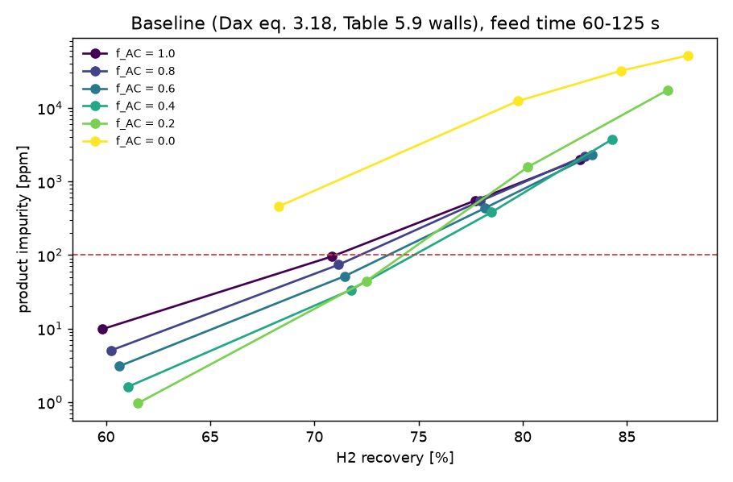
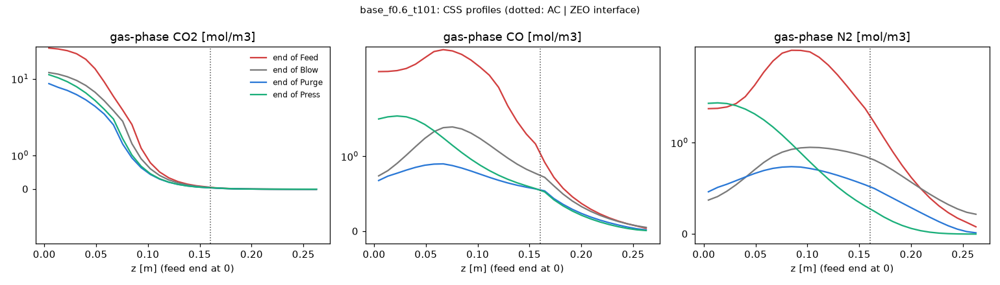

# Step 4 — layered bed (HY2SEPS-AC + HY2SEPS-ZEO)

Generated by `scripts/run_layered.py` (cases cached in `results/step4/cases/`). Thesis pages are printed pages.

## Final decisions (project lead, 2026-10-10)

1. **Axial dispersion: eq. 3.18 is the baseline for all layers and geometries. Eq. 5.20 is REJECTED** (not carried
   as a scenario). Evidence: (i) eq. 3.18 is the thesis's own correlation (Table 4.7, p.123) and reproduces the Dax
   of Tables 5.7/5.9 within 1.15-1.24x (gate 3 table below, kept); (ii) step 2 used the tabulated Dax and matched
   the MEASURED breakthrough curves (15/18 breakthrough times within 10 %), so the measured data support the
   eq. 3.18 magnitude and contradict a 51-55x larger dispersion; (iii) eq. 5.20 (Wakao-Funazkri form) is applied
   here at Re 1-2, below and at the edge of its stated validity (3 < Re < 10000, p.172).
2. **Wall heat transfer from each geometry's own source:** compact Lopes column h_w = 55, U = 50 W/m2/K (Table 5.9)
   in every layer, as in the step-3 baseline; Yang (2008) geometry their internal 38.5 and external 14.2 W/m2/K
   (`layered_4bed_yang2008.yaml`; combined into U by eq. 5.29). Note for step 5: industrial-scale columns are close
   to adiabatic.
3. **CSS acceleration, required before step 6** (near-constraint points are the most important and the slowest to
   converge; unconverged CSS would be label noise exactly at the constraint): warm start from the nearest converged
   CSS state plus Anderson acceleration of the cycle map; same CSS criterion, never declared on an accelerated
   iterate (>= 10 plain cycles at the end); verified against brute force on >= 10 cases spanning 20-2000 ppm
   (impurity within 1e-3 relative, recovery within 0.05 pp); the 4 capped cases rerun.
4. **Trends b and e: NOT reproduced, no tuning.** b: CH4 limits the AC-only bed, consistent with CH4 having the
   slowest micropore kinetics on HY2SEPS-AC. e: the single-column emulation of Yang's 4-bed 10-step cycle spends
   42-70 % of the feed H2 on product pressurisation, so its absolute recovery is not comparable. **Limitation for
   the paper:** the single-column emulation gives absolute recoveries below industrial (multi-bed) values.
5. Step 4 rerun with the new baseline (eq. 3.18, wall values per item 2, accelerated CSS); all pre-declared gates
   re-evaluated below. The first step-4 run (eq. 5.20 / eq. 3.18 with correlation walls, brute-force CSS) is in
   commit b23e20a; its eq. 3.18 cases are the brute-force references of the acceleration check.
6. **Step 4 closed (project lead, 2026-10-11):** gates 1-2 pass, gate 3 settled by decisions 1-2, trends b and e
   recorded as not reproduced (decision 4). The CSS wall time of p90 13.8 min (above the 10-min target) is accepted:
   parallel runs absorb it (step-5 compute plan).

## Verdict (rerun with the decided baseline)

| gate | result |
|---|---|
| 1. Numerical (CSS, mole balance, grid N -> 2N, interface, CSS acceleration vs brute force) | PASS |
| 2. Limit case: AC5-KS through the layered code = frozen step-3 baseline | PASS |
| 3. Correlations vs Tables 5.7 / 5.9 (factor 1.5) | FAIL as pre-declared (Dax eq. 5.20, h_w eq. 5.31, U eq. 5.29); resolved by decisions 1-2: Dax eq. 3.18 PASS (adopted), h_w / U from the apparatus |
| 4. Qualitative trends a-e (baseline) | a. reproduced; b. not reproduced; c. reproduced; d. reproduced; e. not reproduced |
| Runtime per CSS, layered bed (target <= 10 min wall) | median 5.9, 90th percentile 13.8, max 87.1 min |

## Summary

* **Gates.** 1 PASS (33/33 cases at CSS; mole balance 6.6e-7; grid N -> 2N 0.007 pp and 7.9 %; tests;
  acceleration vs brute force 14/14). 2 PASS (AC5-KS limit = frozen step-3 baseline within 0.02 %). 3 FAIL as
  pre-declared for eqs 5.20, 5.31, 5.29, resolved by decisions 1-2 (eq. 3.18 adopted, 1.15-1.24x; walls from each
  geometry's source). 4: a, c, d reproduced; **b and e NOT reproduced, no tuning** (decision 4): b, CH4 limits the
  AC-only bed (323 ppm of 550 at t_feed 101 s), consistent with CH4 having the slowest micropore kinetics on
  HY2SEPS-AC; e, product pressurisation takes 42-70 % of the feed H2 in the single-column emulation of Yang's
  4-bed cycle. **Limitation for the paper:** single-column emulation gives absolute recoveries below industrial
  multi-bed values.
* **CSS acceleration** (warm start + safeguarded Anderson). Verification on 14 configurations, 25-1766 ppm, cold
  start, against brute force continued to a 10x tighter criterion: impurity within 8.9e-4 relative (worst
  f0.4_t101), recovery within 0.0006 pp; the 26 ppm / 1144-cycle case (f0.2_t80) +6.5e-5. With the step-3 criterion
  alone one case missed (f0.0_t60, -2.5e-3): the gate was kept and the CSS criterion tightened (impurity change
  < 1e-5 over the final >= 10 plain cycles); cost: baseline p90 10.3 -> 13.8 min, check max 8.0 -> 11.2 min.
  The 4 cases capped at 2000 brute-force cycles now converge in 4.6-12.7 min (baseline) and 6.6-8.3 min (cold
  start), within -4.5e-4 to +1.3e-3 of the extrapolated brute-force limit (not gated).
* **Wall time per CSS** (shared machine, 7 workers): brute force median 14.0, p90 96.3, max 104.0 min; accelerated
  median 5.9, p90 13.8, max 87.1 min. The 10-min target holds for the median, not for p90 / max. The maximum is
  f0.2_t125 (1.7 % impurity, far from the constraint): its CO2 front creeps through the zeolite at constant speed
  for ~1500 cycles, a drift rather than a geometric approach, which extrapolation cannot predict.


## Model

* Column: the step-2/3 finite-volume model with per-cell adsorbent properties. Layers carry their own bed porosity,
  particle properties, isotherm, kinetics and transport coefficients (Dax, lambda, kf, hf, hw, U, Dp); at a layer
  interface the dispersion and conduction coefficients take the harmonic mean of the two cells. Interfaces must lie
  on a cell face (checked); the face flux is single-valued, so gas concentration, temperature and flux are
  continuous by construction (tests in `tests/test_layered.py`).
* HY2SEPS-AC (feed end) and HY2SEPS-ZEO (product end): multisite Langmuir extended to mixtures (Tables 2.7, 2.8);
  micropore/crystal Dc/rc2 refitted to the measured values (Tables 3.12, 3.15; errata E4, E5 convention); particle
  properties of Tables 3.10 / 3.13; bed porosity of the ch.3 breakthrough columns (0.394 / 0.391, assumed to hold in
  the compact column); LDF factors Omega_m = 8 (cylindrical extrudates, eq. 3.17), Omega_c = 3 (AC, p.98) and 15
  (ZEO, p.104); tortuosity 2 (pp.96, 102). Solid heat capacities are not reported: 880 (AC) and 920 J/kg/K (ZEO),
  assumed.
* Transport: Dax by eq. 3.18 (decision 1); lambda, kf, hf and Dp by the thesis correlations (eqs 5.17-5.23) at
  the feed conditions, per layer (`src/h2psa/transport.py`); the macropore diffusivities quoted on pp.97/103 are
  molecular diffusion in He at 1 bar and 303 K divided by tau = 2 (Chapman-Enskog reproduces them within 3-14 %),
  so at PSA conditions Dp follows from eq. 5.17 with the same tau. Wall: h_w = 55, U = 50 W/m2/K (Table 5.9) in the
  compact column; h_w = 38.5, U = 12.2 W/m2/K (Yang's 38.5 and 14.2 through eq. 5.29) in the Yang column.
* Cycle: the frozen step-3 baseline (cycle B of the experiment, beta_P = 0.102 s-1, EP = pure H2, purge
  0.261 mmol/s), compact column (0.267 m x 5 cm), Lopes feed at 5 bar and 303 K; feed time and feed flow varied for
  the trends. Productivity uses the adsorbent mass of the layered bed.
* CSS (`CycleRunner.run_to_css(accel=True)`, decision 3): warm start from the converged CSS state of the nearest
  case of the same geometry, grid and adsorbents (Euclidean distance in f_AC, t_feed / 110 s, feed-flow ratio; Yang:
  u / 5.2 cm/s), from the cases finished when the case starts; then Anderson acceleration (type II, memory 5) of
  the cycle map on the state scaled by the solver's variable scales, with the cumulative mole counters excluded,
  concentrations and loadings clipped at zero, and the memory dropped whenever the residual grows above twice its
  best value. When the max-norm of the scaled residual G(x) - x falls below 1e-6, or has not halved in 20
  accelerated cycles (stagnation: the residual floor set by the integration tolerance, or Anderson stalled in a
  strongly nonlinear breakthrough transition), plain cycles follow, and CSS is
  declared only by the step-3 criterion (relative change of ppm, recovery and bed-averaged loadings < 1e-4 over 10
  cycles, mole balance < 0.1 %) evaluated over >= 10 consecutive plain cycles, tightened by one condition on the
  impurity: its relative change over those cycles < 1e-5 (see the acceleration check); after 30 plain cycles
  without CSS the acceleration restarts with an empty memory.

## Gate 1 — numerical

| check | value | limit | result |
|---|---|---|---|
| CSS reached (step-3 criterion + impurity change < 1e-5, >= 10 plain cycles), all cases | 33/33 | all | PASS |
| per-cycle mole balance, worst cycle of all cases | 6.6e-07 | < 1e-3 | PASS |
| grid N 30 -> 60, f_AC 0.6: recovery | 0.007 pp | < 0.3 pp | PASS |
| grid N 30 -> 60, f_AC 0.6: impurity | 7.9 % | < 10 % | PASS |
| interface and CSS-acceleration tests (tests/test_layered.py, test_cycle.py) | 21 passed in 202.20s (0:03:22) | all pass | PASS |
| accelerated vs brute-force CSS (ppm within 1e-3 rel., recovery within 0.05 pp) | 14/14, ppm 25-1766 | all, >= 10 cases, 20-2000 ppm | PASS |

### CSS acceleration vs brute force

Configurations of the first step-4 run (Dax eq. 3.18, correlation walls), whose brute-force CSS is cached, run again
from the He-filled column (cold start, no warm start) with Anderson acceleration. The step-3 criterion stops the
slow brute-force runs short of the fixed point (the 26 ppm case was still rising 0.03 ppm per 100 cycles at its
stop), so the brute-force reference is the first-run CSS state continued with plain cycles under a 10x tighter
criterion (change < 1e-5 over 10 cycles; `ext_cycles` more cycles); `d_ppm_vs_stop` compares with the original
stop. Gate: impurity within 1e-3 relative and recovery within 0.05 pp of the reference; the 4 cases that hit the
2000-cycle cap are compared with the geometric extrapolation of their brute-force drift (reported, not gated):

| case | brute_cycles | brute_min | ext_cycles | accel_cycles | accelerated | accel_min | ppm_brute_stop | ppm_brute_ref | ppm_accel | d_ppm_vs_stop | d_ppm_rel | rec_brute_ref | rec_accel | d_rec_pp | result |
|---|---|---|---|---|---|---|---|---|---|---|---|---|---|---|---|
| f1.0_t80 | 87 | 2.7 | 25 | 52 | 20 | 1.7 | 74.458 | 74.460 | 74.460 | +3.0e-05 | +2.6e-06 | 69.896 | 69.896 | -0.0000 | PASS |
| f1.0_t101 | 110 | 4.5 | 39 | 55 | 26 | 1.9 | 435.428 | 435.434 | 435.438 | +2.2e-05 | +9.1e-06 | 76.823 | 76.823 | -0.0000 | PASS |
| f1.0_t125 | 173 | 5.8 | 60 | 42 | 30 | 1.5 | 1630.520 | 1630.612 | 1630.630 | +6.8e-05 | +1.1e-05 | 81.895 | 81.895 | +0.0000 | PASS |
| f0.8_t80 | 87 | 3.9 | 29 | 45 | 22 | 1.9 | 56.445 | 56.444 | 56.443 | -3.3e-05 | -1.3e-05 | 70.209 | 70.209 | -0.0000 | PASS |
| f0.8_t101 | 204 | 14.0 | 631 | 70 | 59 | 3.4 | 423.392 | 423.860 | 423.883 | +1.2e-03 | +5.4e-05 | 77.058 | 77.058 | +0.0001 | PASS |
| f0.8_t125 | 1268 | 67.7 | 786 | 90 | 79 | 4.0 | 1764.376 | 1766.479 | 1766.949 | +1.5e-03 | +2.7e-04 | 82.078 | 82.078 | +0.0002 | PASS |
| f0.6_t80 | 107 | 4.6 | 434 | 70 | 56 | 3.4 | 39.584 | 39.598 | 39.595 | +2.7e-04 | -7.4e-05 | 70.514 | 70.514 | -0.0000 | PASS |
| f0.6_t101 | 967 | 52.4 | 1164 | 115 | 90 | 5.4 | 335.170 | 335.670 | 335.550 | +1.1e-03 | -3.6e-04 | 77.276 | 77.276 | -0.0001 | PASS |
| f0.4_t80 | 741 | 31.8 | 679 | 97 | 82 | 3.9 | 25.430 | 25.454 | 25.448 | +7.1e-04 | -2.4e-04 | 70.803 | 70.803 | -0.0001 | PASS |
| f0.4_t101 | 1727 | 87.9 | 1405 | 117 | 102 | 5.2 | 269.657 | 270.314 | 270.074 | +1.5e-03 | -8.9e-04 | 77.538 | 77.537 | -0.0006 | PASS |
| f0.2_t80 | 1144 | 50.4 | 710 | 111 | 100 | 4.7 | 26.006 | 26.068 | 26.069 | +2.4e-03 | +6.5e-05 | 71.392 | 71.392 | +0.0000 | PASS |
| f0.0_t60 | 1477 | 60.4 | 629 | 269 | 165 | 11.2 | 381.406 | 382.343 | 382.435 | +2.7e-03 | +2.4e-04 | 67.835 | 67.835 | +0.0002 | PASS |
| f0.6_t101_flow0.8 | 97 | 4.2 | 362 | 78 | 51 | 3.4 | 30.653 | 30.660 | 30.660 | +2.3e-04 | +3.6e-06 | 70.720 | 70.720 | -0.0000 | PASS |
| yang_u5.20 | 269 | 13.2 | 74 | 91 | 80 | 4.3 | 50.390 | 50.389 | 50.388 | -2.9e-05 | -9.6e-06 | 54.607 | 54.608 | +0.0001 | PASS |
| f0.6_t125 | 2000 | 97.4 | – | 141 | 130 | 6.6 | 1649.194 | 1665.408 | 1664.666 | +9.4e-03 | -4.5e-04 | 82.307 | 82.318 | +0.0116 | capped brute force: vs extrapolation, not gated |
| f0.4_t125 | 2000 | 104.0 | – | 172 | 161 | 8.3 | 1889.241 | 1968.290 | 1968.046 | +4.2e-02 | -1.2e-04 | 82.760 | 82.811 | +0.0508 | capped brute force: vs extrapolation, not gated |
| f0.2_t101 | 2000 | 103.4 | – | 154 | 143 | 7.1 | 574.433 | 578.185 | 578.963 | +7.9e-03 | +1.3e-03 | 78.593 | 78.600 | +0.0065 | capped brute force: vs extrapolation, not gated |
| f0.6_t101_flow1.2 | 2000 | 96.3 | – | 139 | 122 | 6.7 | 1514.927 | 1526.125 | 1526.118 | +7.4e-03 | -4.2e-06 | 81.722 | 81.731 | +0.0086 | capped brute force: vs extrapolation, not gated |

Before the ppm condition (CSS by the step-3 criterion alone, `results/step4/accel_check_tol4/`), the
slowest cases stopped up to 2.5e-3 short of the reference, because their final plain cycles drift by less than 1e-4
per 10 cycles while still far from the fixed point (the stall rule hands over to plain cycles earlier than a
residual of 1e-6). Per the project lead's instruction the gate was not relaxed; the CSS criterion was tightened
(impurity change < 1e-5 over the final >= 10 plain cycles, all other conditions unchanged) and the check rerun
(table above). The check before tightening:

| case | accel_cycles | accel_min | ppm_brute_ref | ppm_accel | d_ppm_rel | d_rec_pp | result |
|---|---|---|---|---|---|---|---|
| f1.0_t80 | 39 | 1.3 | 74.460 | 74.459 | -1.5e-05 | -0.0000 | PASS |
| f1.0_t101 | 38 | 1.4 | 435.434 | 435.448 | +3.3e-05 | -0.0000 | PASS |
| f1.0_t125 | 41 | 1.4 | 1630.612 | 1630.627 | +9.1e-06 | +0.0000 | PASS |
| f0.8_t80 | 33 | 1.2 | 56.444 | 56.442 | -2.3e-05 | -0.0000 | PASS |
| f0.8_t101 | 70 | 2.8 | 423.860 | 423.883 | +5.4e-05 | +0.0001 | PASS |
| f0.8_t125 | 90 | 3.8 | 1766.479 | 1766.949 | +2.7e-04 | +0.0002 | PASS |
| f0.6_t80 | 67 | 2.9 | 39.598 | 39.595 | -6.5e-05 | -0.0000 | PASS |
| f0.6_t101 | 101 | 4.6 | 335.670 | 335.543 | -3.8e-04 | -0.0001 | PASS |
| f0.4_t80 | 93 | 4.0 | 25.454 | 25.448 | -2.4e-04 | -0.0001 | PASS |
| f0.4_t101 | 113 | 5.1 | 270.314 | 270.073 | -8.9e-04 | -0.0006 | PASS |
| f0.2_t80 | 111 | 5.1 | 26.068 | 26.069 | +6.5e-05 | +0.0000 | PASS |
| f0.0_t60 | 171 | 7.0 | 382.343 | 381.379 | -2.5e-03 | -0.0021 | FAIL |
| f0.6_t101_flow0.8 | 62 | 2.5 | 30.660 | 30.660 | +2.4e-05 | -0.0000 | PASS |
| yang_u5.20 | 91 | 4.6 | 50.389 | 50.388 | -9.6e-06 | +0.0001 | PASS |
| f0.6_t125 | 141 | 6.1 | 1665.408 | 1664.666 | -4.5e-04 | +0.0116 | capped brute force: vs extrapolation, not gated |
| f0.4_t125 | 172 | 8.0 | 1968.290 | 1968.046 | -1.2e-04 | +0.0508 | capped brute force: vs extrapolation, not gated |
| f0.2_t101 | 154 | 7.4 | 578.185 | 578.963 | +1.3e-03 | +0.0065 | capped brute force: vs extrapolation, not gated |
| f0.6_t101_flow1.2 | 133 | 5.5 | 1526.125 | 1526.127 | +1.7e-06 | +0.0086 | capped brute force: vs extrapolation, not gated |

Wall time per CSS [min] (shared machine, 7 workers):

| run | n | median | p90 | max |
|---|---|---|---|---|
| first step-4 run, brute force (Dax eq. 3.18 cases) | 31 | 14.0 | 96.3 | 104.0 |
| this run, warm start + Anderson (all baseline cases) | 31 | 5.9 | 13.8 | 87.1 |
| acceleration check, brute force to the step-3 criterion (same configurations) | 18 | 41.1 | 99.2 | 104.0 |
| acceleration check, cold start + Anderson | 18 | 4.2 | 7.5 | 11.2 |
| before the ppm condition: all baseline cases | 31 | 5.1 | 10.3 | 86.8 |
| before the ppm condition: acceleration check | 18 | 4.3 | 7.1 | 8.0 |

## Gate 2 — limit case

AC5-KS (Table 5.9 group 1-4 transport carried on the layer, adsorbent mass from the bed) as one layer and split into
two identical layers (0.6 | 0.4), against the frozen step-3 baseline (`results/step3/cases/cor_exp.pkl`):

| case | recovery | recovery_step3 | d_rec_pp | ppm | ppm_step3 | d_ppm_rel | result |
|---|---|---|---|---|---|---|---|
| limit_ac5ks | 78.429 | 78.429 | +0.0001 | 143.92 | 143.90 | +0.02% | PASS |
| limit_ac5ks_split | 78.429 | 78.429 | +0.0001 | 143.91 | 143.90 | +0.01% | PASS |

## Gate 3 — correlations vs the author's tables (AC5-KS, compact unit)

Ratio recomputed / tabulated (Table 5.7: breakthrough runs at 5 bar, 323 K; Table 5.9: PSA groups; flow
5.0e-5 m3/s at 298 K and 1 bar; scalar coefficients use the mole-fraction mean of the species' mixture
diffusivities, eq. 5.18; U with T_w - T_inf = 10 K, air properties at 300 K, AISI 304 wall):

| coefficient | n | min_ratio | max_ratio | result |
|---|---|---|---|---|
| Dax (5.20) | 8 | 51.23 | 54.56 | FAIL (rejected) |
| lambda (5.21) | 8 | 1.00 | 1.00 | PASS |
| kf (5.23) | 8 | 0.96 | 1.21 | PASS |
| hf (5.22) | 8 | 0.97 | 0.98 | PASS |
| hw (5.31) | 8 | 1.78 | 7.75 | FAIL |
| U (5.29) | 8 | 0.06 | 0.07 | FAIL |
| Dax (3.18) | 8 | 1.15 | 1.24 | PASS (adopted) |
| Dp H2 (5.17) | 8 | 1.00 | 1.00 | PASS |
| Dp CO2 (5.17) | 8 | 0.99 | 1.00 | PASS |
| Dp CO (5.17) | 5 | 1.00 | 1.00 | PASS |
| Dp CH4 (5.17) | 4 | 1.00 | 1.00 | PASS |
| Dp N2 (5.17) | 4 | 1.00 | 1.00 | PASS |

| case | P_bar | T_K | Re | Dax (5.20) | lambda (5.21) | kf (5.23) | hf (5.22) | hw (5.31) | U (5.29) | Dax (3.18) | Dp H2 (5.17) | Dp CO2 (5.17) | Dp CO (5.17) | Dp CH4 (5.17) | Dp N2 (5.17) |
|---|---|---|---|---|---|---|---|---|---|---|---|---|---|---|---|
| Table 5.7 run 1 | 5.00 | 323.00 | 2.78 | 51.23 | 1.00 | 0.97 | 0.98 | 5.24 | 0.07 | 1.15 | 1.00 | 1.00 | – | – | – |
| Table 5.7 run 2 | 5.00 | 323.00 | 1.39 | 51.23 | 1.00 | 0.97 | 0.98 | 7.75 | 0.07 | 1.15 | 1.00 | 1.00 | – | – | – |
| Table 5.7 run 3 | 5.00 | 323.00 | 6.59 | 51.23 | 1.00 | 0.96 | 0.98 | 1.78 | 0.06 | 1.15 | 1.00 | 1.00 | – | – | – |
| Table 5.7 run 4 | 5.00 | 323.00 | 2.63 | 52.59 | 1.00 | 1.11 | 0.97 | 5.33 | 0.07 | 1.20 | 1.00 | 1.00 | 1.00 | – | – |
| Table 5.7 run 5 | 5.00 | 323.00 | 2.42 | 54.56 | 1.00 | 1.21 | 0.98 | 5.66 | 0.07 | 1.24 | 1.00 | 0.99 | 1.00 | 1.00 | 1.00 |
| Table 5.9 group 1-4 | 5.00 | 303.00 | 2.10 | 52.58 | 1.00 | 1.17 | 0.97 | 6.06 | 0.07 | 1.21 | 1.00 | 0.99 | 1.00 | 1.00 | 1.00 |
| Table 5.9 group 5-14 | 10.00 | 303.00 | 2.10 | 52.75 | 1.00 | 1.18 | 0.97 | 6.06 | 0.07 | 1.21 | 1.00 | 0.99 | 1.00 | 1.00 | 1.00 |
| Table 5.9 group 15-17 | 10.00 | 323.00 | 2.00 | 54.45 | 1.00 | 1.17 | 0.98 | 6.36 | 0.07 | 1.23 | 1.00 | 1.00 | 1.00 | 1.00 | 1.00 |

Reading of gate 3. Eq. 5.20 is coded as printed on p.172 (eps Dax / Dm = 20 + 0.5 Sc Re). The text there
gives its validity as 3 < Re < 10000; the compact-unit conditions have Re = 1.4-6.6 (Table 5.7) and 2.0-2.1
(Table 5.9), the HY2SEPS layers 1.2-1.7. At these Re the constant 20 dominates (0.5 Sc Re < 4) and Dax is about
21 Dm / eps, i.e. 51-55x the tabulated values, also for run 3 inside the stated range; the ch.3 correlation
(eq. 3.18) reproduces them within 1.15-1.24x. h_w and U in Tables 5.7 / 5.9 do not vary with flow, pressure or
temperature (55 and 50 W/m2/K throughout), so they are set values of the apparatus. Decisions 1 and 2: eq. 3.18 is
adopted, eq. 5.20 rejected, and h_w, U come from each geometry's own source; the correlation values of eqs 5.31 and
5.29 are no longer used.

Coefficients used for the HY2SEPS layers (experiment feed, 5 bar, 303 K, compact column):

| layer | Dax | lambda | kf | hf | hw | U | Dp H2 | Dp CO2 | Dp CH4 | Dp CO | Dp N2 | Re |
|---|---|---|---|---|---|---|---|---|---|---|---|---|
| AC | 1.41e-05 | 0.869 | 0.0179 | 156 | 55 | 50 | 6.77e-06 | 5.75e-06 | 4.57e-06 | 4.5e-06 | 4.44e-06 | 1.71 |
| ZEO | 1.26e-05 | 0.858 | 0.0231 | 202 | 55 | 50 | 6.77e-06 | 5.75e-06 | 4.57e-06 | 4.5e-06 | 4.44e-06 | 1.23 |

## Gate 4 — qualitative trends (no tuning)

Declared before running: a — every layered fraction 0.2-0.8 has a lower impurity than AC only at the midpoint of
the common recovery range of the feed-time scans; b — the largest impurity of AC only (t_feed 101 s) is N2 or CO
and is lower at f_AC = 0.6; c — recovery at 99.99 % purity (interpolated in ln ppm along the feed-time scan) is
highest at an interior fraction and higher than at both ends (an end that never reaches 99.99 % counts as worse);
d — impurity and recovery both rise monotonically with feed time for every fraction, and with feed flow
(x0.8, 1, 1.2) at f_AC = 0.6; e — Yang geometry/feed: at least one velocity gives <= 100 ppm with 60-80 %
recovery.

| trend | result | detail |
|---|---|---|
| a. layered purer than AC only at equal recovery | reproduced | f_AC 0.8: 81.2 vs AC only 113 ppm at 71.5 %; f_AC 0.6: 55.6 vs AC only 119 ppm at 71.7 %; f_AC 0.4: 35.3 vs AC only 125 ppm at 71.9 %; f_AC 0.2: 39.1 vs AC only 133 ppm at 72.1 % |
| b. limiting impurity of AC only is N2 or CO; zeolite reduces it | not reproduced | AC only (t_feed 101 s): CO2 1.31, CH4 323, CO 89.7, N2 137 ppm -> limiting CH4; f_AC 0.6: CH4 175 ppm |
| c. interior optimum zeolite fraction (recovery at 99.99 %) | reproduced | f_AC 1.0: 71.0 %; f_AC 0.8: 72.2 %; f_AC 0.6: 73.6 %; f_AC 0.4: 74.8 %; f_AC 0.2: 74.3 %; f_AC 0.0: not reached |
| d. longer feed / higher feed velocity: lower purity, higher recovery | reproduced | feed time monotone for all fractions; feed flow x0.8/1.0/1.2 (f_AC 0.6): ppm 40.4/434/2.07e+03, recovery 71.6/78.2/82.8 |
| e. Yang 2008: >= 99.99 % with 60-80 % recovery at 3.1-5.2 cm/s | not reproduced | 3.14 cm/s: 0.31 ppm, 29.5 %; 3.90 cm/s: 5.19 ppm, 43.6 %; 4.70 cm/s: 44.1 ppm, 53.6 %; 5.20 cm/s: 123 ppm, 58.2 % |

Trend e diagnostic — where the feed H2 goes in the Yang emulation (mol per mol H2 fed, CSS cycle; purge_in and
press_in are product H2 returned to the column):

| case | product | ED_to_partner | blow_purge_out | purge_in | press_in | recovery |
|---|---|---|---|---|---|---|
| base_yang_u3.14 | 1.090 | 0.651 | 0.756 | 0.100 | 0.695 | 0.295 |
| base_yang_u3.90 | 1.094 | 0.516 | 0.612 | 0.100 | 0.558 | 0.436 |
| base_yang_u4.70 | 1.097 | 0.420 | 0.510 | 0.100 | 0.461 | 0.536 |
| base_yang_u5.20 | 1.098 | 0.376 | 0.462 | 0.100 | 0.416 | 0.582 |





### All cases

| case | f_ac | t_feed | flow | yang | N | recovery | ppm | purity | productivity | CO2_ppm | CH4_ppm | CO_ppm | N2_ppm | cycles | acc | warm | retries | wall_min | cpu_min |
|---|---|---|---|---|---|---|---|---|---|---|---|---|---|---|---|---|---|---|---|
| base_f1.0_t60 | 1.0 | 60 | – | – | – | 59.82 | 9.79 | 99.99902 | 44.2 | 4.08e-05 | 9.08 | 0.168 | 0.547 | 46 | 14 | base_f0.8_t80 | 0 | 1.6 | 1.5 |
| base_f1.0_t80 | 1.0 | 80 | – | – | – | 70.84 | 95.4 | 99.99046 | 66.6 | 0.0114 | 72.8 | 6.87 | 15.7 | 44 | 13 | base_f0.8_t80 | 0 | 1.5 | 1.4 |
| base_f1.0_t101 | 1.0 | 101 | – | – | – | 77.72 | 550 | 99.94498 | 88.1 | 1.31 | 323 | 89.7 | 137 | 43 | 23 | base_f0.8_t80 | 0 | 1.6 | 1.5 |
| base_f1.0_t125 | 1.0 | 125 | – | – | – | 82.75 | 2.01e+03 | 99.79925 | 110.3 | 65.5 | 953 | 473 | 516 | 37 | 20 | base_f0.8_t101 | 0 | 1.4 | 1.3 |
| base_f0.8_t60 | 0.8 | 60 | – | – | – | 60.23 | 5.03 | 99.99950 | 41.7 | 0.00259 | 3.86 | 0.684 | 0.48 | 311 | 90 | base_f0.6_t101 | 0 | 10.8 | 10.7 |
| base_f0.8_t80 | 0.8 | 80 | – | – | – | 71.16 | 73.6 | 99.99264 | 62.6 | 0.000963 | 40 | 19.1 | 14.5 | 50 | 33 | base_f0.6_t60 | 0 | 1.9 | 1.8 |
| base_f0.8_t101 | 0.8 | 101 | – | – | – | 77.96 | 541 | 99.94592 | 82.6 | 0.959 | 211 | 194 | 135 | 74 | 63 | base_f0.6_t101 | 0 | 2.9 | 2.8 |
| base_f0.8_t125 | 0.8 | 125 | – | – | – | 82.97 | 2.22e+03 | 99.77823 | 103.5 | 64.2 | 746 | 880 | 527 | 94 | 83 | base_f0.6_t125 | 0 | 3.9 | 3.8 |
| base_f0.6_t60 | 0.6 | 60 | – | – | – | 60.64 | 3.08 | 99.99969 | 39.4 | 0.000476 | 2.38 | 0.441 | 0.264 | 95 | 63 | base_f0.4_t80 | 0 | 3.6 | 3.5 |
| base_f0.6_t80 | 0.6 | 80 | – | – | – | 71.47 | 51.7 | 99.99483 | 59.1 | 0.0108 | 28.9 | 12.8 | 9.99 | 365 | 73 | base_f0.6_t101 | 0 | 13.8 | 13.7 |
| base_f0.6_t101 | 0.6 | 101 | – | – | – | 78.18 | 434 | 99.95662 | 77.9 | 0.378 | 175 | 144 | 115 | 164 | 121 | base_f0.2_t101 | 0 | 6.5 | 6.4 |
| base_f0.6_t125 | 0.6 | 125 | – | – | – | 83.34 | 2.29e+03 | 99.77140 | 97.6 | 55.1 | 765 | 898 | 568 | 110 | 99 | base_f0.4_t125 | 0 | 4.6 | 4.5 |
| base_f0.4_t60 | 0.4 | 60 | – | – | – | 61.04 | 1.61 | 99.99984 | 37.4 | 0.000293 | 1.24 | 0.253 | 0.118 | 497 | 172 | base_f0.0_t60 | 0 | 18.5 | 17.9 |
| base_f0.4_t80 | 0.4 | 80 | – | – | – | 71.76 | 33.6 | 99.99664 | 55.9 | 0.00143 | 20.1 | 7.85 | 5.69 | 156 | 101 | base_f0.2_t80 | 0 | 6.4 | 6.1 |
| base_f0.4_t101 | 0.4 | 101 | – | – | – | 78.49 | 380 | 99.96199 | 73.7 | 0.219 | 168 | 112 | 99.7 | 172 | 116 | base_f0.0_t101 | 0 | 7.2 | 6.8 |
| base_f0.4_t125 | 0.4 | 125 | – | – | – | 84.29 | 3.75e+03 | 99.62531 | 93.1 | 173 | 1.27e+03 | 1.41e+03 | 892 | 98 | 87 | base_f0.0_t125 | 0 | 4.7 | 4.4 |
| base_f0.2_t60 | 0.2 | 60 | – | – | – | 61.53 | 0.962 | 99.99990 | 35.7 | -4.21e-11 | 0.717 | 0.177 | 0.0685 | 427 | 209 | base_f0.0_t125 | 0 | 16.2 | 15.4 |
| base_f0.2_t80 | 0.2 | 80 | – | – | – | 72.50 | 44.4 | 99.99556 | 53.5 | 0.00742 | 25.5 | 10.5 | 8.36 | 132 | 108 | base_f0.0_t101 | 0 | 5.6 | 5.2 |
| base_f0.2_t101 | 0.2 | 101 | – | – | – | 80.23 | 1.56e+03 | 99.84363 | 71.3 | 5.6 | 638 | 501 | 419 | 279 | 175 | – | 0 | 12.7 | 11.8 |
| base_f0.2_t125 | 0.2 | 125 | – | – | – | 86.94 | 1.74e+04 | 98.25964 | 90.9 | 6.67e+03 | 4.24e+03 | 3.59e+03 | 2.9e+03 | 1809 | 837 | – | 0 | 87.1 | 85.9 |
| base_f0.0_t60 | 0.0 | 60 | – | – | – | 68.30 | 459 | 99.95411 | 37.6 | 0.431 | 257 | 128 | 73.7 | 204 | 162 | – | 0 | 7.9 | 7.3 |
| base_f0.0_t80 | 0.0 | 80 | – | – | – | 79.76 | 1.24e+04 | 98.76199 | 55.8 | 3.52e+03 | 3.99e+03 | 2.96e+03 | 1.91e+03 | 240 | 105 | – | 0 | 10.2 | 9.4 |
| base_f0.0_t101 | 0.0 | 101 | – | – | – | 84.72 | 3.2e+04 | 96.79886 | 71.4 | 1.5e+04 | 8.15e+03 | 5.03e+03 | 3.83e+03 | 181 | 77 | – | 0 | 8.2 | 7.5 |
| base_f0.0_t125 | 0.0 | 125 | – | – | – | 87.93 | 5.17e+04 | 94.83495 | 87.2 | 2.86e+04 | 1.15e+04 | 6.65e+03 | 4.84e+03 | 123 | 50 | – | 1 | 5.9 | 5.4 |
| base_f0.6_t101_flow0.8 | 0.6 | 101 | 0.8 | – | – | 71.61 | 40.4 | 99.99596 | 57.1 | 0.00674 | 21.8 | 10.3 | 8.33 | 259 | 153 | base_f0.4_t125 | 0 | 9.8 | 9.5 |
| base_f0.6_t101_flow1.2 | 0.6 | 101 | 1.2 | – | – | 82.78 | 2.07e+03 | 99.79300 | 98.9 | 37 | 730 | 791 | 512 | 180 | 130 | base_f0.4_t101 | 0 | 7.4 | 7.3 |
| base_f0.6_t101_grid2N | 0.6 | 101 | – | – | 60 | 78.18 | 400 | 99.96002 | 77.9 | 0.217 | 163 | 130 | 106 | 167 | 124 | – | 0 | 10.9 | 10.1 |
| base_yang_u3.14 | – | – | – | 3.14 | 34 | 29.54 | 0.31 | 99.99997 | 52.9 | -2.81e-14 | 0.306 | 0.00355 | – | 48 | 25 | – | 0 | 2.2 | 2.0 |
| base_yang_u3.90 | – | – | – | 3.90 | 34 | 43.63 | 5.19 | 99.99948 | 97.0 | -3.36e-12 | 4.99 | 0.195 | – | 47 | 35 | – | 0 | 2.2 | 2.0 |
| base_yang_u4.70 | – | – | – | 4.70 | 34 | 53.56 | 44.1 | 99.99559 | 143.5 | 1.12e-10 | 40.2 | 3.87 | – | 58 | 47 | – | 0 | 2.8 | 2.6 |
| base_yang_u5.20 | – | – | – | 5.20 | 34 | 58.20 | 123 | 99.98768 | 172.5 | -2.1e-10 | 107 | 16.1 | – | 59 | 48 | – | 0 | 3.0 | 2.7 |
| limit_ac5ks | – | – | – | – | – | 78.43 | 144 | 99.98561 | 96.8 | 4.98 | 3.3 | 63.5 | 72.1 | 50 | 24 | – | 0 | 2.2 | 2.2 |
| limit_ac5ks_split | – | – | – | – | – | 78.43 | 144 | 99.98561 | 96.8 | 4.97 | 3.3 | 63.5 | 72.1 | 44 | 24 | – | 0 | 2.1 | 2.1 |

## Runtime

Layered-bed CSS with warm start + Anderson: median 5.9, 90th percentile 13.8, max
87.1 min wall (5.4 min CPU median), on a shared machine; before (first step-4 run,
brute force) see the timing table under gate 1. Other speed-up of this step: multisite Langmuir solved by Newton in
ln(s) with warm start (about 5x per cycle).

## Step-6 preparation (draft, not run): `configs/design_space.yaml`

```yaml
# DRAFT (step 4) — design space for the step-6 surrogate / optimisation. Not used by any script yet.
# Process: single-column layered-bed PSA emulation of the compact LSRE unit (Lopes 2010, ch.5), cycle with
# Feed, ED1..n, Blow, Purge (H2), EPn..1, Press (H2); frozen step-3 baseline model (see docs/validation/step3.md)
# with the step-4 layered baseline: HY2SEPS-AC | HY2SEPS-ZEO, Dax eq. 3.18, h_w = 55 and U = 50 W/m2/K (Table 5.9),
# CSS by warm start + Anderson acceleration (docs/validation/step4.md).

decision_variables:
  t_feed:          {bounds: [40, 150], units: s,
                    why: "below ~40 s the 10-s pressure law (beta_P = 0.102 s-1) and the ED/EP steps dominate the cycle; at 125 s the step-4 baseline scan is already at 2000-17000 ppm (f_AC 0.2-1.0) for the experiment's feed flow; 150 s keeps the infeasible side sampled"}
  purge_to_feed:   {bounds: [0.02, 0.30], units: "mol H2 purge / mol H2 fed per cycle",
                    why: "below ~2 % the bed is not regenerated (impurities accumulate); above ~30 % the purge alone costs more recovery than any competitive PSA loses"}
  P_high:          {bounds: [4.0, 8.5], units: bar,
                    why: "H2 partial pressure 0.79 P_high stays inside the 0-7 bar isotherm fits (Tables 2.7, 2.8); Table 5.10 spans 5-10 bar"}
  P_low:           {bounds: [0.3, 1.5], units: bar,
                    why: "vacuum pump on the blowdown line (Fig. 5.5; experiment 0.5 bar); 0.3 bar assumed pump limit, 1.5 bar = no vacuum"}
  f_zeolite:       {bounds: [0.0, 1.0], units: "-", grid: "multiples of 1/N (N = 30): the AC | ZEO interface must lie on a cell face",
                    why: "from AC only to zeolite only; the interior optimum is gate-4 trend c"}
  n_equalisations: {values: [1, 2, 3], units: "-",
                    why: "cycles A (1) and B (3) of Lopes; 2 as in Yang (2008)"}
  feed_flow:       {bounds: [0.5, 1.5], units: "x 5.0e-5 m3/s at 298 K, 1 bar (Table 5.4)",
                    why: "assumed mass-flow-controller range around the experiment's set point; trend d (velocity)"}

fixed_by_apparatus:
  column: {L: 0.267 m, d_wi: 0.05 m, wall: "stainless steel, 3 mm (assumed)", source: "Table 5.3"}
  pressure_law: {beta_P: 0.102 s-1, source: "fitted to the author's simulation (Fig. 5.20a); valve characteristic"}
  feed: {composition: "0.79 H2 / 0.17 CO2 / 0.021 CH4 / 0.012 CO / 0.007 N2", T: 303 K, source: "Table 5.4"}
  heater: {T_ambient: 303 K, source: "Fig. 5.6; = feed temperature"}
  step_times_not_varied: {t_eq: 16 s, t_press: 21 s, t_blow: "201 s (or set by the cycle time)", note: "candidates to free later"}

objectives:
  - {name: h2_recovery, sense: maximise, definition: "eq. (5.49): (H2 product - H2 in purge and pressurisation) / H2 fed"}
  - {name: productivity, sense: maximise, definition: "eq. (5.50): net H2 per kg adsorbent per day"}

constraints:
  - {name: h2_purity, definition: "eq. (5.48), feed components only", limit: ">= 99.99 % (impurities <= 100 ppm)",
     note: "step 7 replaces the point constraint by a conformal-prediction bound"}

scenarios_carried_to_step7: [ep_inflow_ed_gas, noncompetitive_h2, kinetics_table4.10, thermal_range_ends]   # Dax eq. 5.20 rejected (step 4)
```
