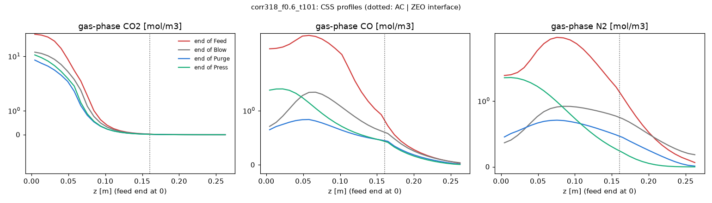
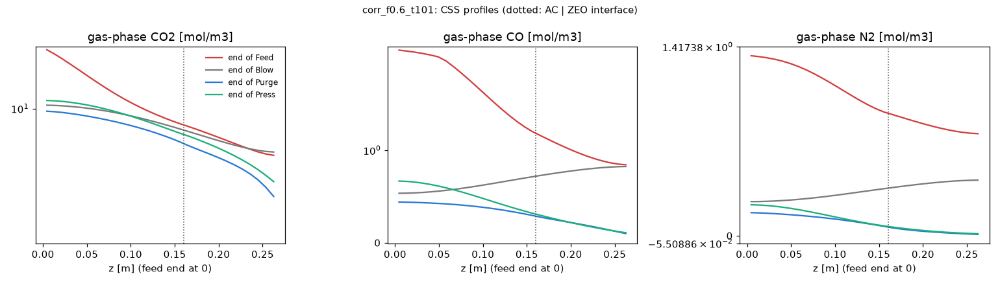

# Step 4 — layered bed (HY2SEPS-AC + HY2SEPS-ZEO)

Generated by `scripts/run_layered.py` (cases cached in `results/step4/cases/`). Thesis pages are printed pages.

## Verdict

| gate | result |
|---|---|
| 1. Numerical (CSS, mole balance, grid N -> 2N, interface) | FAIL |
| 2. Limit case: AC5-KS through the layered code = frozen step-3 baseline | PASS |
| 3. Correlations vs Tables 5.7 / 5.9 (factor 1.5) | FAIL |
| 4. Qualitative trends a-e, Dax eq. 5.20 (pre-declared correlations) | a. not reproduced; b. not reproduced; c. not reproduced; d. reproduced; e. not reproduced |
| 4'. Same trends with Dax eq. 3.18 (sensitivity) | a. reproduced; b. not reproduced; c. reproduced; d. reproduced; e. not reproduced |
| Runtime per CSS, layered bed (target <= 10 min wall) | median 7.1 min, max 104.0 min |

**Status: stopped for a decision (gates 1, 3 and 4 fail; none of the causes found is a coding bug).**

* **Gate 2 passes exactly** (AC5-KS through the layered code = step-3 baseline, also split into two layers), the
  mole balance closes to 1e-6, the grid test and the interface tests pass: the layered implementation is verified.
* **Gate 1 fails on CSS only:** 4 of 64 cases stop at 2000 cycles, all with Dax eq. 3.18, low AC fraction or long
  feed, and impurity 570-1900 ppm (far from 100 ppm). The drift is monotone and geometric; extrapolated it adds
  0.7-4.2 % to their ppm (table below), which changes no trend verdict. Cause: the bed-averaged CO2 loading is still
  rising (slow CO2 uptake in the zeolite layer), not a numerical fault. The same physics makes CSS slow near the constraint (f_AC 0.2, 26 ppm:
  1144 cycles, 50 min), so the <= 10 min runtime target holds for the median (7.1 min) but not for every case.
  The two 3.14 cm/s Yang cases first crashed on a BDF step-size underflow; with the per-step rtol retry
  (`CycleRunner._solve`, 1-3 steps re-solved) they reach CSS.
* **Gate 3 fails on Dax, h_w and U; not a coding bug.** Eq. 5.20 is coded as printed (checked against p.172) and
  gives 51-55x the tabulated Dax at every condition, including Table 5.7 run 3 (Re = 6.6, inside the validity range
  3 < Re < 10000 stated on p.172); the PSA groups (Re 2.0-2.1) and the HY2SEPS layers (Re 1.2-1.7) lie below that
  range. The ch.3 correlation (eq. 3.18) reproduces the tabulated Dax within 1.15-1.24x, so the author's tables
  are not eq. 5.20 output. The tabulated
  h_w = 55 and U = 50 W/m2/K are identical in all runs and groups (set values, not correlation output).
  Dp, lambda, kf and hf pass (0.96-1.21).
* **Gate 4 depends on Dax.** With the pre-declared eq. 5.20 the bed is dispersion-dominated: no case gets below
  1.4e4 ppm at the Lopes feed, so a, b, c fail (d holds). With eq. 3.18: a, c, d reproduced (zeolite lowers impurity
  at equal recovery; interior optimum f_AC 0.4, about 3.6 pp more recovery at 99.99 % than AC only), b not (the AC-only
  limiting impurity is CH4, not N2 or CO; HY2SEPS-AC is not the Calgon carbon of the literature), e not (99.99 %
  is reached at 3.1-5.2 cm/s but with 26-55 % recovery: in the declared single-column emulation, pressurisation
  with product takes 42-70 % of the feed H2 and the bed is under-used, 0.1-80 ppm; see the H2 split below).

**Options for the project lead**

1. Dax for the HY2SEPS layers: (A, recommended) adopt eq. 3.18 as the baseline: it reproduces the author's tables
   (eq. 5.20 does not, and the PSA conditions are outside its stated Re range); eq. 5.20 becomes a scenario carried to step 7 (it moves
   impurity by two orders of magnitude, the same kind of model-form uncertainty as the EP gas). (B) Keep eq. 5.20:
   the compact unit never reaches 99.99 % and step 6 has no active constraint.
2. h_w and U: (A, recommended) use the Table 5.9 set values (55, 50 W/m2/K) for every layer of the compact column,
   since they belong to the apparatus and the step-3 baseline uses them; this needs a rerun of the eq. 3.18 scan
   (several hours on 7 workers). (B) Keep the correlation values (h_w 333, U 3.4 W/m2/K) and report the bias.
3. CSS: (A) accept the 4 capped cases with their extrapolated drift (all > 500 ppm). (B) Raise the cap to 5000
   cycles for them (about 4 h each). (C) Add CSS acceleration before step 6, where slow CSS near the constraint sets
   the cost of every training point.
4. Trends b and e stay recorded as not reproduced (no tuning). Optional diagnostic for e only: rerun the Yang cases
   with a declared longer feed time, stated beforehand as a different emulation, not a fit.

## Model

* Column: the step-2/3 finite-volume model with per-cell adsorbent properties. Layers carry their own bed porosity,
  particle properties, isotherm, kinetics and transport coefficients (Dax, lambda, kf, hf, hw, U, Dp); at a layer
  interface the dispersion and conduction coefficients take the harmonic mean of the two cells. Interfaces must lie
  on a cell face (checked); the face flux is single-valued, so gas concentration, temperature and flux are
  continuous by construction (tests in `tests/test_layered.py`).
* HY2SEPS-AC (feed end) and HY2SEPS-ZEO (product end): multisite Langmuir extended to mixtures (Tables 2.7, 2.8);
  micropore/crystal Dc/rc2 refitted to the measured values (Tables 3.12, 3.15; errata E4, E5 convention); particle
  properties of Tables 3.10 / 3.13; bed porosity of the ch.3 breakthrough columns (0.394 / 0.391, assumed to hold in
  the compact column); LDF factors Omega_m = 8 (cylindrical extrudates, eq. 3.17), Omega_c = 3 (AC, p.98) and 15
  (ZEO, p.104); tortuosity 2 (pp.96, 102). Solid heat capacities are not reported: 880 (AC) and 920 J/kg/K (ZEO),
  assumed.
* Transport: thesis correlations at the feed conditions, per layer (`src/h2psa/transport.py`). The macropore
  diffusivities quoted on pp.97/103 are molecular diffusion in He at 1 bar and 303 K divided by tau = 2
  (Chapman-Enskog reproduces them within 3-14 %, `tests/test_transport.py`); at PSA conditions Dp follows from
  eq. 5.17 with the same tau (Knudsen neglected as on p.96).
* Cycle: the frozen step-3 baseline (cycle B of the experiment, beta_P = 0.102 s-1, EP = pure H2, purge
  0.261 mmol/s), compact column (0.267 m x 5 cm), Lopes feed at 5 bar and 303 K; feed time and feed flow varied for
  the trends. Productivity uses the adsorbent mass of the layered bed.

## Gate 1 — numerical

| check | value | limit | result |
|---|---|---|---|
| CSS reached (step-3 criterion), all cases | 60/64 | all | FAIL |
| per-cycle mole balance, worst cycle of all cases | 1.1e-06 | < 1e-3 | PASS |
| grid N 30 -> 60, f_AC 0.6, Dax eq5.20: recovery | 0.001 pp | < 0.3 pp | PASS |
| grid N 30 -> 60, f_AC 0.6, Dax eq5.20: impurity | 0.2 % | < 10 % | PASS |
| grid N 30 -> 60, f_AC 0.6, Dax eq3.18: recovery | 0.003 pp | < 0.3 pp | PASS |
| grid N 30 -> 60, f_AC 0.6, Dax eq3.18: impurity | 8.0 % | < 10 % | PASS |
| interface tests (tests/test_layered.py) | 4 passed in 6.04s | all pass | PASS |

Cases stopped at 2000 cycles without meeting the CSS criterion (relative change < 1e-4 over 10 cycles). The drift is
monotone and decays geometrically (no oscillation, mole balance closed); the extrapolation sums the remaining
geometric series of the per-500-cycle ppm increments:

| case | cycles | ppm | css_change | css_change_by | ppm_drift_last_500 | ppm_extrapolated | extrapolated_rel |
|---|---|---|---|---|---|---|---|
| corr318_f0.6_t125 | 2000 | 1649.2 | 3.3e-04 | q_CO2 | 13.6 | 1665 | +1.0% |
| corr318_f0.4_t125 | 2000 | 1889.2 | 6.6e-04 | q_CO2 | 49.2 | 1968 | +4.2% |
| corr318_f0.2_t101 | 2000 | 574.4 | 1.3e-04 | ppm | 6.2 | 578 | +0.7% |
| corr318_f0.6_t101_flow1.2 | 2000 | 1514.9 | 2.7e-04 | q_CO2 | 10.3 | 1526 | +0.7% |

## Gate 2 — limit case

AC5-KS (Table 5.9 group 1-4 transport carried on the layer, adsorbent mass from the bed) as one layer and split into
two identical layers (0.6 | 0.4), against the frozen step-3 baseline (`results/step3/cases/cor_exp.pkl`):

| case | recovery | recovery_step3 | d_rec_pp | ppm | ppm_step3 | d_ppm_rel | result |
|---|---|---|---|---|---|---|---|
| limit_ac5ks | 78.429 | 78.429 | +0.0000 | 143.90 | 143.90 | +0.00% | PASS |
| limit_ac5ks_split | 78.429 | 78.429 | -0.0000 | 143.90 | 143.90 | -0.00% | PASS |

## Gate 3 — correlations vs the author's tables (AC5-KS, compact unit)

Ratio recomputed / tabulated (Table 5.7: breakthrough runs at 5 bar, 323 K; Table 5.9: PSA groups; flow
5.0e-5 m3/s at 298 K and 1 bar; scalar coefficients use the mole-fraction mean of the species' mixture
diffusivities, eq. 5.18; U with T_w - T_inf = 10 K, air properties at 300 K, AISI 304 wall):

| coefficient | n | min_ratio | max_ratio | result |
|---|---|---|---|---|
| Dax (5.20) | 8 | 51.23 | 54.56 | FAIL |
| lambda (5.21) | 8 | 1.00 | 1.00 | PASS |
| kf (5.23) | 8 | 0.96 | 1.21 | PASS |
| hf (5.22) | 8 | 0.97 | 0.98 | PASS |
| hw (5.31) | 8 | 1.78 | 7.75 | FAIL |
| U (5.29) | 8 | 0.06 | 0.07 | FAIL |
| Dax (3.18) | 8 | 1.15 | 1.24 | alternative, not gated |
| Dp H2 (5.17) | 8 | 1.00 | 1.00 | PASS |
| Dp CO2 (5.17) | 8 | 0.99 | 1.00 | PASS |
| Dp CO (5.17) | 5 | 1.00 | 1.00 | PASS |
| Dp CH4 (5.17) | 4 | 1.00 | 1.00 | PASS |
| Dp N2 (5.17) | 4 | 1.00 | 1.00 | PASS |

| case | P_bar | T_K | Re | Dax (5.20) | lambda (5.21) | kf (5.23) | hf (5.22) | hw (5.31) | U (5.29) | Dax (3.18) | Dp H2 (5.17) | Dp CO2 (5.17) | Dp CO (5.17) | Dp CH4 (5.17) | Dp N2 (5.17) |
|---|---|---|---|---|---|---|---|---|---|---|---|---|---|---|---|
| Table 5.7 run 1 | 5.00 | 323.00 | 2.78 | 51.23 | 1.00 | 0.97 | 0.98 | 5.24 | 0.07 | 1.15 | 1.00 | 1.00 | – | – | – |
| Table 5.7 run 2 | 5.00 | 323.00 | 1.39 | 51.23 | 1.00 | 0.97 | 0.98 | 7.75 | 0.07 | 1.15 | 1.00 | 1.00 | – | – | – |
| Table 5.7 run 3 | 5.00 | 323.00 | 6.59 | 51.23 | 1.00 | 0.96 | 0.98 | 1.78 | 0.06 | 1.15 | 1.00 | 1.00 | – | – | – |
| Table 5.7 run 4 | 5.00 | 323.00 | 2.63 | 52.59 | 1.00 | 1.11 | 0.97 | 5.33 | 0.07 | 1.20 | 1.00 | 1.00 | 1.00 | – | – |
| Table 5.7 run 5 | 5.00 | 323.00 | 2.42 | 54.56 | 1.00 | 1.21 | 0.98 | 5.66 | 0.07 | 1.24 | 1.00 | 0.99 | 1.00 | 1.00 | 1.00 |
| Table 5.9 group 1-4 | 5.00 | 303.00 | 2.10 | 52.58 | 1.00 | 1.17 | 0.97 | 6.06 | 0.07 | 1.21 | 1.00 | 0.99 | 1.00 | 1.00 | 1.00 |
| Table 5.9 group 5-14 | 10.00 | 303.00 | 2.10 | 52.75 | 1.00 | 1.18 | 0.97 | 6.06 | 0.07 | 1.21 | 1.00 | 0.99 | 1.00 | 1.00 | 1.00 |
| Table 5.9 group 15-17 | 10.00 | 323.00 | 2.00 | 54.45 | 1.00 | 1.17 | 0.98 | 6.36 | 0.07 | 1.23 | 1.00 | 1.00 | 1.00 | 1.00 | 1.00 |

Reading of gate 3. Eq. 5.20 is coded as printed on p.172 (eps Dax / Dm = 20 + 0.5 Sc Re). The text there
gives its validity as 3 < Re < 10000; the compact-unit conditions have Re = 1.4-6.6 (Table 5.7) and 2.0-2.1
(Table 5.9), the HY2SEPS layers 1.2-1.7. At these Re the constant 20 dominates (0.5 Sc Re < 4) and Dax is about
21 Dm / eps, i.e. 51-55x the tabulated values, also for run 3 inside the stated range; the ch.3 correlation
(eq. 3.18) reproduces them within 1.15-1.24x. h_w and U in
Tables 5.7 / 5.9 do not vary with flow, pressure or temperature (55 and 50 W/m2/K throughout), so they are set
values and the correlations cannot be expected to reproduce them. Per the pre-declared rule the HY2SEPS layers use
the correlations anyway (eq. 5.20 Dax, eq. 5.31 h_w, eq. 5.29 U); expected bias: Dax about 50x too high relative
to what the author would have used, h_w about 6x higher and U about 15x lower than the apparatus values (a more
adiabatic column). Eq. 3.18 is carried as the sensitivity.

Coefficients used for the HY2SEPS layers (experiment feed, 5 bar, 303 K, compact column):

| layer | dax_rule | Dax | lambda | kf | hf | hw | U | Dp H2 | Dp CO2 | Dp CH4 | Dp CO | Dp N2 | Re |
|---|---|---|---|---|---|---|---|---|---|---|---|---|---|
| AC | eq5.20 | 0.000676 | 0.869 | 0.0179 | 156 | 333 | 3.37 | 6.77e-06 | 5.75e-06 | 4.57e-06 | 4.5e-06 | 4.44e-06 | 1.71 |
| AC | eq3.18 | 1.41e-05 | 0.869 | 0.0179 | 156 | 333 | 3.37 | 6.77e-06 | 5.75e-06 | 4.57e-06 | 4.5e-06 | 4.44e-06 | 1.71 |
| ZEO | eq5.20 | 0.000677 | 0.858 | 0.0231 | 202 | 333 | 3.37 | 6.77e-06 | 5.75e-06 | 4.57e-06 | 4.5e-06 | 4.44e-06 | 1.23 |
| ZEO | eq3.18 | 1.26e-05 | 0.858 | 0.0231 | 202 | 333 | 3.37 | 6.77e-06 | 5.75e-06 | 4.57e-06 | 4.5e-06 | 4.44e-06 | 1.23 |

## Gate 4 — qualitative trends (no tuning)

Declared before running: a — every layered fraction 0.2-0.8 has a lower impurity than AC only at the midpoint of
the common recovery range of the feed-time scans; b — the largest impurity of AC only (t_feed 101 s) is N2 or CO
and is lower at f_AC = 0.6; c — recovery at 99.99 % purity (interpolated in ln ppm along the feed-time scan) is
highest at an interior fraction and higher than at both ends (an end that never reaches 99.99 % counts as worse);
d — impurity and recovery both rise monotonically with feed time for every fraction, and with feed flow
(x0.8, 1, 1.2) at f_AC = 0.6; e — Yang geometry/feed: at least one velocity gives <= 100 ppm with 60-80 %
recovery.

### Dax eq. 5.20 (pre-declared correlation set)

| trend | result | detail |
|---|---|---|
| a. layered purer than AC only at equal recovery | not reproduced | f_AC 0.8: 2.31e+04 vs AC only 2e+04 ppm at 71.4 %; f_AC 0.6: 2.48e+04 vs AC only 2.06e+04 ppm at 72.2 %; f_AC 0.4: 2.69e+04 vs AC only 2.12e+04 ppm at 73.1 %; f_AC 0.2: 3.05e+04 vs AC only 2.21e+04 ppm at 74.3 % |
| b. limiting impurity of AC only is N2 or CO; zeolite reduces it | not reproduced | AC only (t_feed 101 s): CO2 1.8e+04, CH4 3.53e+03, CO 1.7e+03, N2 1.19e+03 ppm -> limiting CO2; f_AC 0.6: CO2 2.4e+04 ppm |
| c. interior optimum zeolite fraction (recovery at 99.99 %) | not reproduced | no fraction reaches 99.99 % in the feed-time scan (not evaluable) |
| d. longer feed / higher feed velocity: lower purity, higher recovery | reproduced | feed time monotone for all fractions; feed flow x0.8/1.0/1.2 (f_AC 0.6): ppm 2.62e+04/3.23e+04/3.83e+04, recovery 72.9/79.1/83.2 |
| e. Yang 2008: >= 99.99 % with 60-80 % recovery at 3.1-5.2 cm/s | not reproduced | 3.14 cm/s: 0.41 ppm, 25.6 %; 3.90 cm/s: 4.44 ppm, 39.9 %; 4.70 cm/s: 30.3 ppm, 50.0 %; 5.20 cm/s: 79.1 ppm, 54.6 % |

### Dax eq. 3.18 (sensitivity: the ch.3 correlation that reproduces Tables 5.7/5.9)

| trend | result | detail |
|---|---|---|
| a. layered purer than AC only at equal recovery | reproduced | f_AC 0.8: 62.5 vs AC only 88.1 ppm at 70.6 %; f_AC 0.6: 42.9 vs AC only 92.9 ppm at 70.8 %; f_AC 0.4: 27 vs AC only 97.9 ppm at 71.0 %; f_AC 0.2: 24.4 vs AC only 104 ppm at 71.2 % |
| b. limiting impurity of AC only is N2 or CO; zeolite reduces it | not reproduced | AC only (t_feed 101 s): CO2 0.495, CH4 257, CO 65.3, N2 112 ppm -> limiting CH4; f_AC 0.6: CH4 137 ppm |
| c. interior optimum zeolite fraction (recovery at 99.99 %) | reproduced | f_AC 1.0: 71.1 %; f_AC 0.8: 72.2 %; f_AC 0.6: 73.4 %; f_AC 0.4: 74.7 %; f_AC 0.2: 74.5 %; f_AC 0.0: not reached |
| d. longer feed / higher feed velocity: lower purity, higher recovery | reproduced | feed time monotone for all fractions; feed flow x0.8/1.0/1.2 (f_AC 0.6): ppm 30.7/335/1.51e+03, recovery 70.7/77.3/81.7 |
| e. Yang 2008: >= 99.99 % with 60-80 % recovery at 3.1-5.2 cm/s | not reproduced | 3.14 cm/s: 0.0974 ppm, 25.6 %; 3.90 cm/s: 1.78 ppm, 39.9 %; 4.70 cm/s: 16.9 ppm, 49.9 %; 5.20 cm/s: 50.4 ppm, 54.6 % |

Trend e diagnostic — where the feed H2 goes in the Yang emulation (mol per mol H2 fed, CSS cycle; purge_in and
press_in are product H2 returned to the column):

| case | product | ED_to_partner | blow_purge_out | purge_in | press_in | recovery |
|---|---|---|---|---|---|---|
| corr318_yang_u3.14 | 1.060 | 0.660 | 0.779 | 0.100 | 0.704 | 0.256 |
| corr318_yang_u3.90 | 1.064 | 0.524 | 0.635 | 0.100 | 0.565 | 0.399 |
| corr318_yang_u4.70 | 1.066 | 0.427 | 0.533 | 0.100 | 0.467 | 0.499 |
| corr318_yang_u5.20 | 1.068 | 0.382 | 0.485 | 0.100 | 0.421 | 0.546 |
| corr_yang_u3.14 | 1.060 | 0.660 | 0.779 | 0.100 | 0.704 | 0.256 |
| corr_yang_u3.90 | 1.064 | 0.523 | 0.634 | 0.100 | 0.565 | 0.399 |
| corr_yang_u4.70 | 1.067 | 0.427 | 0.533 | 0.100 | 0.467 | 0.500 |
| corr_yang_u5.20 | 1.068 | 0.382 | 0.485 | 0.100 | 0.421 | 0.546 |






### All cases

| case | dax | f_ac | t_feed | flow | yang | N | recovery | ppm | purity | productivity | CO2_ppm | CH4_ppm | CO_ppm | N2_ppm | cycles | retries | wall_min | cpu_min |
|---|---|---|---|---|---|---|---|---|---|---|---|---|---|---|---|---|---|---|
| corr_f1.0_t60 | corr | 1.0 | 60 | – | – | – | 59.29 | 1.41e+04 | 98.58883 | 43.8 | 1.06e+04 | 2.07e+03 | 875 | 562 | 123 | 0 | 3.7 | 2.9 |
| corr_f1.0_t80 | corr | 1.0 | 80 | – | – | – | 70.24 | 1.92e+04 | 98.08385 | 66.1 | 1.42e+04 | 2.8e+03 | 1.27e+03 | 854 | 117 | 0 | 3.0 | 2.7 |
| corr_f1.0_t101 | corr | 1.0 | 101 | – | – | – | 77.03 | 2.44e+04 | 97.56113 | 87.3 | 1.8e+04 | 3.53e+03 | 1.7e+03 | 1.19e+03 | 111 | 0 | 3.5 | 2.8 |
| corr_f1.0_t125 | corr | 1.0 | 125 | – | – | – | 81.96 | 3.02e+04 | 96.98156 | 109.2 | 2.21e+04 | 4.31e+03 | 2.21e+03 | 1.61e+03 | 106 | 0 | 3.5 | 2.8 |
| corr_f0.8_t60 | corr | 0.8 | 60 | – | – | – | 60.82 | 1.7e+04 | 98.29644 | 42.1 | 1.3e+04 | 2.29e+03 | 1.13e+03 | 644 | 185 | 0 | 6.2 | 5.1 |
| corr_f0.8_t80 | corr | 0.8 | 80 | – | – | – | 71.45 | 2.31e+04 | 97.68649 | 62.9 | 1.74e+04 | 3.15e+03 | 1.58e+03 | 989 | 156 | 0 | 6.0 | 4.6 |
| corr_f0.8_t101 | corr | 0.8 | 101 | – | – | – | 78.02 | 2.93e+04 | 97.06554 | 82.7 | 2.19e+04 | 4e+03 | 2.06e+03 | 1.39e+03 | 136 | 0 | 4.4 | 3.8 |
| corr_f0.8_t125 | corr | 0.8 | 125 | – | – | – | 82.78 | 3.61e+04 | 96.38895 | 103.2 | 2.67e+04 | 4.88e+03 | 2.61e+03 | 1.87e+03 | 122 | 0 | 5.1 | 3.8 |
| corr_f0.6_t60 | corr | 0.6 | 60 | – | – | – | 62.49 | 1.84e+04 | 98.16103 | 40.6 | 1.4e+04 | 2.33e+03 | 1.3e+03 | 710 | 236 | 0 | 7.6 | 6.5 |
| corr_f0.6_t80 | corr | 0.6 | 80 | – | – | – | 72.76 | 2.53e+04 | 97.47447 | 60.2 | 1.9e+04 | 3.31e+03 | 1.81e+03 | 1.13e+03 | 192 | 0 | 7.9 | 5.8 |
| corr_f0.6_t101 | corr | 0.6 | 101 | – | – | – | 79.10 | 3.23e+04 | 96.76870 | 78.8 | 2.4e+04 | 4.29e+03 | 2.36e+03 | 1.62e+03 | 165 | 0 | 5.7 | 4.9 |
| corr_f0.6_t125 | corr | 0.6 | 125 | – | – | – | 83.68 | 4e+04 | 95.99645 | 98.0 | 2.95e+04 | 5.32e+03 | 3e+03 | 2.21e+03 | 144 | 0 | 4.4 | 4.1 |
| corr_f0.4_t60 | corr | 0.4 | 60 | – | – | – | 64.32 | 2e+04 | 97.99667 | 39.4 | 1.53e+04 | 2.43e+03 | 1.49e+03 | 810 | 264 | 0 | 8.5 | 7.4 |
| corr_f0.4_t80 | corr | 0.4 | 80 | – | – | – | 74.23 | 2.79e+04 | 97.21389 | 57.9 | 2.08e+04 | 3.56e+03 | 2.11e+03 | 1.35e+03 | 214 | 0 | 7.2 | 6.2 |
| corr_f0.4_t101 | corr | 0.4 | 101 | – | – | – | 80.32 | 3.6e+04 | 96.39607 | 75.4 | 2.65e+04 | 4.72e+03 | 2.79e+03 | 2e+03 | 184 | 0 | 6.4 | 5.5 |
| corr_f0.4_t125 | corr | 0.4 | 125 | – | – | – | 84.71 | 4.51e+04 | 95.49464 | 93.6 | 3.28e+04 | 5.98e+03 | 3.58e+03 | 2.73e+03 | 161 | 0 | 4.9 | 4.6 |
| corr_f0.2_t60 | corr | 0.2 | 60 | – | – | – | 66.66 | 2.3e+04 | 97.70254 | 38.6 | 1.72e+04 | 2.81e+03 | 1.88e+03 | 1.06e+03 | 284 | 0 | 7.9 | 7.6 |
| corr_f0.2_t80 | corr | 0.2 | 80 | – | – | – | 76.14 | 3.27e+04 | 96.73125 | 56.2 | 2.39e+04 | 4.26e+03 | 2.74e+03 | 1.84e+03 | 232 | 0 | 8.2 | 7.0 |
| corr_f0.2_t101 | corr | 0.2 | 101 | – | – | – | 81.90 | 4.3e+04 | 95.70339 | 72.8 | 3.08e+04 | 5.81e+03 | 3.65e+03 | 2.69e+03 | 199 | 0 | 7.1 | 6.1 |
| corr_f0.2_t125 | corr | 0.2 | 125 | – | – | – | 85.98 | 5.42e+04 | 94.57831 | 89.9 | 3.85e+04 | 7.49e+03 | 4.67e+03 | 3.56e+03 | 172 | 0 | 6.5 | 5.4 |
| corr_f0.0_t60 | corr | 0.0 | 60 | – | – | – | 70.84 | 3.58e+04 | 96.42065 | 39.0 | 2.6e+04 | 4.64e+03 | 3.25e+03 | 1.91e+03 | 283 | 0 | 7.0 | 6.9 |
| corr_f0.0_t80 | corr | 0.0 | 80 | – | – | – | 78.97 | 5.06e+04 | 94.93754 | 55.3 | 3.6e+04 | 7.06e+03 | 4.53e+03 | 3e+03 | 234 | 0 | 7.4 | 6.1 |
| corr_f0.0_t101 | corr | 0.0 | 101 | – | – | – | 83.82 | 6.47e+04 | 93.53120 | 70.7 | 4.57e+04 | 9.39e+03 | 5.68e+03 | 3.93e+03 | 202 | 0 | 6.7 | 5.4 |
| corr_f0.0_t125 | corr | 0.0 | 125 | – | – | – | 87.22 | 7.84e+04 | 92.15960 | 86.5 | 5.54e+04 | 1.16e+04 | 6.75e+03 | 4.68e+03 | 176 | 0 | 5.8 | 4.7 |
| corr_f0.6_t101_flow0.8 | corr | 0.6 | 101 | 0.8 | – | – | 72.93 | 2.62e+04 | 97.37661 | 58.1 | 1.97e+04 | 3.43e+03 | 1.88e+03 | 1.22e+03 | 185 | 0 | 5.7 | 5.2 |
| corr_f0.6_t101_flow1.2 | corr | 0.6 | 101 | 1.2 | – | – | 83.18 | 3.83e+04 | 96.17241 | 99.4 | 2.82e+04 | 5.14e+03 | 2.86e+03 | 2.05e+03 | 150 | 0 | 6.1 | 4.6 |
| corr_f0.6_t101_grid2N | corr | 0.6 | 101 | – | – | 60.0 | 79.10 | 3.22e+04 | 96.77525 | 78.8 | 2.4e+04 | 4.29e+03 | 2.36e+03 | 1.62e+03 | 165 | 0 | 7.1 | 5.9 |
| corr_yang_u3.14 | corr | – | – | – | 3.14 | 34.0 | 25.64 | 0.41 | 99.99996 | 45.9 | 1.64e-10 | 0.399 | 0.0106 | – | 195 | 3 | 7.1 | 7.0 |
| corr_yang_u3.90 | corr | – | – | – | 3.90 | 34.0 | 39.92 | 4.44 | 99.99956 | 88.8 | -1.65e-09 | 4.22 | 0.222 | – | 248 | 0 | 10.9 | 9.3 |
| corr_yang_u4.70 | corr | – | – | – | 4.70 | 34.0 | 49.95 | 30.3 | 99.99697 | 133.8 | -1.4e-08 | 27.6 | 2.7 | – | 269 | 0 | 12.6 | 10.7 |
| corr_yang_u5.20 | corr | – | – | – | 5.20 | 34.0 | 54.64 | 79.1 | 99.99209 | 162.0 | 3.35e-08 | 69.6 | 9.47 | – | 270 | 0 | 12.6 | 11.1 |
| corr318_f1.0_t60 | corr318 | 1.0 | 60 | – | – | – | 58.80 | 7.77 | 99.99922 | 43.5 | 1.91e-05 | 7.22 | 0.118 | 0.428 | 85 | 0 | 3.6 | 2.8 |
| corr318_f1.0_t80 | corr318 | 1.0 | 80 | – | – | – | 69.90 | 74.5 | 99.99255 | 65.7 | 0.00467 | 57.3 | 4.8 | 12.4 | 87 | 0 | 2.7 | 2.6 |
| corr318_f1.0_t101 | corr318 | 1.0 | 101 | – | – | – | 76.82 | 435 | 99.95646 | 87.0 | 0.495 | 257 | 65.3 | 112 | 110 | 0 | 4.5 | 3.8 |
| corr318_f1.0_t125 | corr318 | 1.0 | 125 | – | – | – | 81.89 | 1.63e+03 | 99.83695 | 109.1 | 26.4 | 788 | 372 | 445 | 173 | 0 | 5.8 | 5.6 |
| corr318_f0.8_t60 | corr318 | 0.8 | 60 | – | – | – | 59.22 | 3.91 | 99.99961 | 41.0 | 1.56e-07 | 3.03 | 0.501 | 0.38 | 84 | 0 | 7.5 | 5.3 |
| corr318_f0.8_t80 | corr318 | 0.8 | 80 | – | – | – | 70.21 | 56.4 | 99.99436 | 61.8 | 7.15e-06 | 31.1 | 13.8 | 11.5 | 87 | 0 | 3.9 | 3.3 |
| corr318_f0.8_t101 | corr318 | 0.8 | 101 | – | – | – | 77.06 | 423 | 99.95766 | 81.7 | 0.0348 | 166 | 146 | 111 | 204 | 0 | 14.0 | 12.0 |
| corr318_f0.8_t125 | corr318 | 0.8 | 125 | – | – | – | 82.08 | 1.76e+03 | 99.82356 | 102.3 | 22.9 | 592 | 698 | 451 | 1268 | 0 | 67.7 | 55.0 |
| corr318_f0.6_t60 | corr318 | 0.6 | 60 | – | – | – | 59.64 | 2.4 | 99.99976 | 38.7 | -5.77e-10 | 1.87 | 0.323 | 0.208 | 84 | 0 | 3.5 | 3.1 |
| corr318_f0.6_t80 | corr318 | 0.6 | 80 | – | – | – | 70.51 | 39.6 | 99.99604 | 58.3 | -2.51e-08 | 22.5 | 9.21 | 7.85 | 107 | 0 | 4.6 | 4.0 |
| corr318_f0.6_t101 | corr318 | 0.6 | 101 | – | – | – | 77.28 | 335 | 99.96648 | 77.0 | 0.066 | 137 | 106 | 92.9 | 967 | 0 | 52.4 | 43.4 |
| corr318_f0.6_t125 | corr318 | 0.6 | 125 | – | – | – | 82.31 | 1.65e+03 | 99.83508 | 96.4 | 12.6 | 559 | 627 | 451 | 2000 | 0 | 97.4 | 84.4 |
| corr318_f0.4_t60 | corr318 | 0.4 | 60 | – | – | – | 60.04 | 1.26 | 99.99987 | 36.8 | -2.23e-10 | 0.98 | 0.185 | 0.0924 | 214 | 0 | 8.9 | 7.7 |
| corr318_f0.4_t80 | corr318 | 0.4 | 80 | – | – | – | 70.80 | 25.4 | 99.99746 | 55.2 | 1.82e-05 | 15.5 | 5.54 | 4.36 | 741 | 0 | 31.8 | 27.7 |
| corr318_f0.4_t101 | corr318 | 0.4 | 101 | – | – | – | 77.54 | 270 | 99.97303 | 72.8 | 0.0372 | 124 | 73.4 | 72 | 1727 | 0 | 87.9 | 74.5 |
| corr318_f0.4_t125 | corr318 | 0.4 | 125 | – | – | – | 82.76 | 1.89e+03 | 99.81108 | 91.4 | 8.89 | 703 | 649 | 528 | 2000 | 0 | 104.0 | 88.3 |
| corr318_f0.2_t60 | corr318 | 0.2 | 60 | – | – | – | 60.51 | 0.709 | 99.99993 | 35.1 | -3.12e-08 | 0.543 | 0.118 | 0.0485 | 758 | 0 | 31.8 | 27.1 |
| corr318_f0.2_t80 | corr318 | 0.2 | 80 | – | – | – | 71.39 | 26 | 99.99740 | 52.7 | 2.26e-05 | 16 | 5.44 | 4.59 | 1144 | 0 | 50.4 | 43.4 |
| corr318_f0.2_t101 | corr318 | 0.2 | 101 | – | – | – | 78.59 | 574 | 99.94256 | 69.8 | 0.143 | 258 | 149 | 168 | 2000 | 0 | 103.4 | 87.5 |
| corr318_f0.2_t125 | corr318 | 0.2 | 125 | – | – | – | 85.81 | 1.08e+04 | 98.92310 | 89.7 | 2.42e+03 | 3.23e+03 | 2.96e+03 | 2.16e+03 | 1158 | 0 | 63.8 | 55.0 |
| corr318_f0.0_t60 | corr318 | 0.0 | 60 | – | – | – | 67.83 | 381 | 99.96186 | 37.3 | 0.211 | 218 | 103 | 61 | 1477 | 0 | 60.4 | 52.1 |
| corr318_f0.0_t80 | corr318 | 0.0 | 80 | – | – | – | 79.29 | 1.11e+04 | 98.89300 | 55.5 | 2.7e+03 | 3.77e+03 | 2.83e+03 | 1.77e+03 | 803 | 0 | 36.9 | 31.6 |
| corr318_f0.0_t101 | corr318 | 0.0 | 101 | – | – | – | 84.38 | 3.03e+04 | 96.97495 | 71.1 | 1.36e+04 | 7.98e+03 | 4.94e+03 | 3.77e+03 | 311 | 0 | 14.8 | 12.9 |
| corr318_f0.0_t125 | corr318 | 0.0 | 125 | – | – | – | 87.64 | 4.95e+04 | 95.04855 | 86.9 | 2.67e+04 | 1.14e+04 | 6.58e+03 | 4.83e+03 | 211 | 0 | 10.6 | 9.2 |
| corr318_f0.6_t101_flow0.8 | corr318 | 0.6 | 101 | 0.8 | – | – | 70.72 | 30.7 | 99.99693 | 56.4 | -2.48e-08 | 16.7 | 7.37 | 6.54 | 97 | 0 | 4.2 | 3.6 |
| corr318_f0.6_t101_flow1.2 | corr318 | 0.6 | 101 | 1.2 | – | – | 81.72 | 1.51e+03 | 99.84851 | 97.7 | 9.17 | 543 | 556 | 406 | 2000 | 0 | 96.3 | 84.1 |
| corr318_f0.6_t101_grid2N | corr318 | 0.6 | 101 | – | – | 60.0 | 77.27 | 308 | 99.96918 | 77.0 | 0.0352 | 128 | 94.7 | 85.8 | 943 | 0 | 67.8 | 58.4 |
| corr318_yang_u3.14 | corr318 | – | – | – | 3.14 | 34.0 | 25.59 | 0.0974 | 99.99999 | 45.8 | 4.17e-13 | 0.0968 | 0.000675 | – | 184 | 1 | 6.7 | 6.6 |
| corr318_yang_u3.90 | corr318 | – | – | – | 3.90 | 34.0 | 39.88 | 1.78 | 99.99982 | 88.7 | -3.51e-11 | 1.74 | 0.043 | – | 248 | 0 | 11.2 | 9.5 |
| corr318_yang_u4.70 | corr318 | – | – | – | 4.70 | 34.0 | 49.92 | 16.9 | 99.99831 | 133.7 | 6e-10 | 15.9 | 1 | – | 267 | 0 | 12.7 | 10.9 |
| corr318_yang_u5.20 | corr318 | – | – | – | 5.20 | 34.0 | 54.61 | 50.4 | 99.99496 | 161.9 | -9.68e-11 | 45.8 | 4.55 | – | 269 | 0 | 13.2 | 11.3 |
| limit_ac5ks | – | – | – | – | – | – | 78.43 | 144 | 99.98561 | 96.8 | 4.96 | 3.29 | 63.5 | 72.1 | 158 | 0 | 6.9 | 6.7 |
| limit_ac5ks_split | – | – | – | – | – | – | 78.43 | 144 | 99.98561 | 96.8 | 4.96 | 3.29 | 63.5 | 72.1 | 157 | 0 | 7.8 | 7.5 |

## Runtime

Layered-bed CSS: median 7.1 min wall (5.8 min CPU), max 104.0 min, on a shared
machine. Speed-up done in this step: multisite Langmuir solved by Newton in ln(s) with warm start (about 5x per
cycle).

## Step-6 preparation (draft, not run): `configs/design_space.yaml`

```yaml
# DRAFT (step 4) — design space for the step-6 surrogate / optimisation. Not used by any script yet.
# Process: single-column layered-bed PSA emulation of the compact LSRE unit (Lopes 2010, ch.5), cycle with
# Feed, ED1..n, Blow, Purge (H2), EPn..1, Press (H2); frozen step-3 baseline model (see docs/validation/step3.md).

decision_variables:
  t_feed:          {bounds: [40, 150], units: s,
                    why: "below ~40 s the 10-s pressure law (beta_P = 0.102 s-1) and the ED/EP steps dominate the cycle; at 125 s the step-4 scan is already at 400-1900 ppm (eq. 3.18) for the experiment's feed flow"}
  purge_to_feed:   {bounds: [0.02, 0.30], units: "mol H2 purge / mol H2 fed per cycle",
                    why: "below ~2 % the bed is not regenerated (impurities accumulate); above ~30 % the purge alone costs more recovery than any competitive PSA loses"}
  P_high:          {bounds: [4.0, 8.5], units: bar,
                    why: "H2 partial pressure 0.79 P_high stays inside the 0-7 bar isotherm fits (Tables 2.7, 2.8); Table 5.10 spans 5-10 bar"}
  P_low:           {bounds: [0.3, 1.5], units: bar,
                    why: "vacuum pump on the blowdown line (Fig. 5.5; experiment 0.5 bar); 0.3 bar assumed pump limit, 1.5 bar = no vacuum"}
  f_zeolite:       {bounds: [0.0, 1.0], units: "-", grid: "multiples of 1/N (N = 30): the AC | ZEO interface must lie on a cell face",
                    why: "from AC only to zeolite only; the interior optimum is gate-4 trend c"}
  n_equalisations: {values: [1, 2, 3], units: "-",
                    why: "cycles A (1) and B (3) of Lopes; 2 as in Yang (2008)"}
  feed_flow:       {bounds: [0.5, 1.5], units: "x 5.0e-5 m3/s at 298 K, 1 bar (Table 5.4)",
                    why: "assumed mass-flow-controller range around the experiment's set point; trend d (velocity)"}

fixed_by_apparatus:
  column: {L: 0.267 m, d_wi: 0.05 m, wall: "stainless steel, 3 mm (assumed)", source: "Table 5.3"}
  pressure_law: {beta_P: 0.102 s-1, source: "fitted to the author's simulation (Fig. 5.20a); valve characteristic"}
  feed: {composition: "0.79 H2 / 0.17 CO2 / 0.021 CH4 / 0.012 CO / 0.007 N2", T: 303 K, source: "Table 5.4"}
  heater: {T_ambient: 303 K, source: "Fig. 5.6; = feed temperature"}
  step_times_not_varied: {t_eq: 16 s, t_press: 21 s, t_blow: "201 s (or set by the cycle time)", note: "candidates to free later"}

objectives:
  - {name: h2_recovery, sense: maximise, definition: "eq. (5.49): (H2 product - H2 in purge and pressurisation) / H2 fed"}
  - {name: productivity, sense: maximise, definition: "eq. (5.50): net H2 per kg adsorbent per day"}

constraints:
  - {name: h2_purity, definition: "eq. (5.48), feed components only", limit: ">= 99.99 % (impurities <= 100 ppm)",
     note: "step 7 replaces the point constraint by a conformal-prediction bound"}

scenarios_carried_to_step7: [ep_inflow_ed_gas, noncompetitive_h2, kinetics_table4.10, thermal_range_ends, dax_correlation]
```
